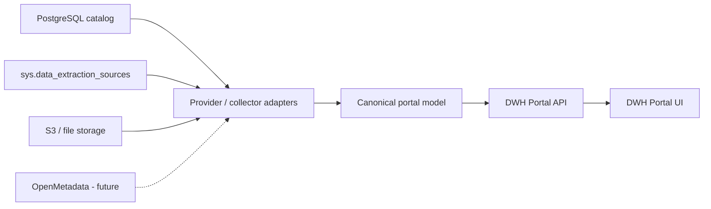
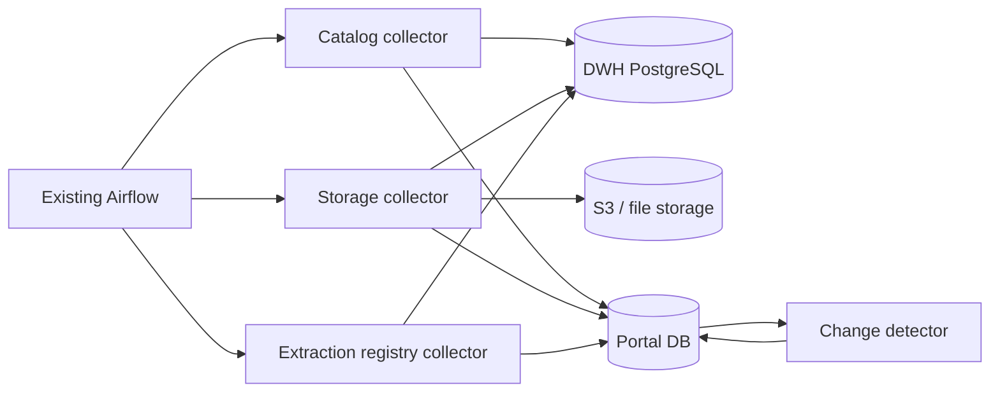
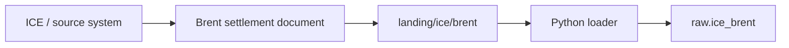
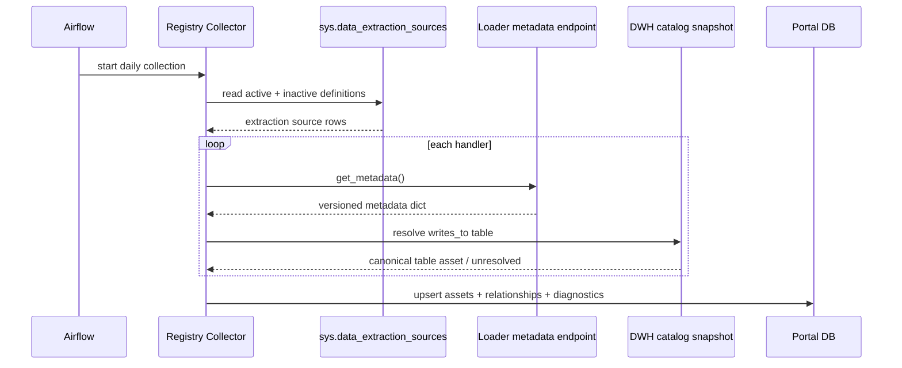
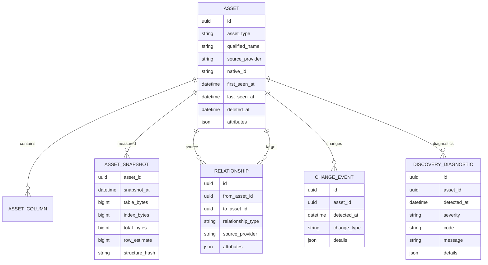
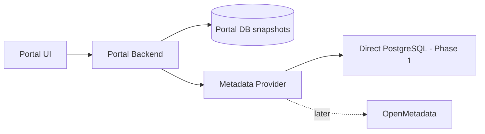

# ADR-002: MVP metadata catalog and source-to-DWH lineage

- **Status:** Proposed for MVP
- **Date:** 2026-09-06
- **Scope:** DWH Portal, Phase 1
- **Decision type:** Architecture / metadata / lineage

## 1. Context

В DWH уже есть полезные метаданные, но полноценной платформы метаданных и
автоматизированного слоя lineage пока нет.

Актуальные источники истины:

1. Системный каталог PostgreSQL и комментарии к объектам БД.
2. `sys.data_extraction_sources` — корневой реестр определений ETL-ingestion.
3. `sys.data_source_items` — реестр бизнес-/source-систем.
4. `sys.data_load_schedules` — реестр расписаний загрузки.
5. Файловое хранилище, описываемое `storage_options`.
6. Реализации загрузчиков, описываемые `load_options`.

OpenMetadata планируется как будущая платформа метаданных, но разработка MVP
не должна зависеть от его развёртывания.

MVP должен поддерживать:

- просмотр объектов DWH;
- фильтрацию и поиск;
- использование хранилища и исторические снимки;
- lineage от источника до DWH;
- обнаружение добавленных, удалённых и структурно изменённых объектов БД;
- стабильный Python-backend, который позже сможет использовать OpenMetadata
  как provider.

Явно отложено на Phase 2:

- AI-диалог;
- аналитика использования/активности БД по query logs.

## 2. Существующая корневая сущность ETL

Корневой реестр ingestion — `sys.data_extraction_sources`.

```sql
CREATE TABLE sys.data_extraction_sources (
    id uuid DEFAULT gen_random_uuid() NOT NULL,
    name varchar NULL,
    descr varchar NULL,
    access_level int4 NULL,
    is_active bool NULL,
    extract_source_type_id int4 NULL,
    extract_options jsonb NULL,
    storage_options jsonb NULL,
    load_options jsonb NULL,
    load_schedule_id uuid NULL,
    data_source_id uuid NULL,
    tags text NULL,
    parent_id uuid NULL,
    comment varchar NULL,
    CONSTRAINT data_extraction_sources_pkey2 PRIMARY KEY (id),
    CONSTRAINT data_extraction_sources_data_source_fk
        FOREIGN KEY (data_source_id) REFERENCES sys.data_source_items(id),
    CONSTRAINT data_extraction_sources_parent_fk
        FOREIGN KEY (parent_id) REFERENCES sys.data_extraction_sources(id),
    CONSTRAINT data_extraction_sources_schedule_fk
        FOREIGN KEY (load_schedule_id) REFERENCES sys.data_load_schedules(id)
);
```

Для текущего MVP поддерживаемая extraction в основном email:

```text
extract_source_type_id = 1
extract_options         = ExtractEmailOptions
storage_options         = ExtractStorageOptions
load_options            = ExtractLoadOptions
```

`load_options.handlers[]` сейчас поддерживает:

- `PythonV0`;
- `Python`;
- `RestApi`.

## 3. Decision

### 3.1 DWH Portal владеет канонической моделью метаданных

Backend портала экспонирует собственную стабильную доменную модель. Он не
отдаёт фронтенду напрямую строки каталога PostgreSQL, ETL JSON-структуры или
будущие сущности OpenMetadata.



Каноническая модель намеренно уже OpenMetadata и достаточно специфична для
продукта портала.

### 3.2 Сбор метаданных — на основе снимков

UI не должен выполнять тяжёлые запросы метаданных/статистики к DWH при загрузке
страницы.

Collectors запускаются периодически, изначально раз в сутки, и сохраняют
нормализованные снимки в Portal DB.



### 3.3 Lineage source-to-DWH восстанавливается из реестра ETL

Первая поддерживаемая цепочка lineage:

```text
Data source
  -> extraction source / logical document
  -> storage location
  -> load handler/process
  -> DWH table
```

Пример:



Граф может быть неполным. Отсутствие метаданных о целевом объекте не должно
инвалидировать всё определение источника.

## 4. Каноническая доменная модель

### 4.1 Asset

```text
Asset
- id: UUID                         # portal identity
- asset_type: enum
- qualified_name: string
- name: string
- description: string | null
- source_provider: string          # postgres, extraction_registry, s3, openmetadata...
- native_id: string | null         # pg OID, registry UUID, OM ID, etc.
- first_seen_at: datetime
- last_seen_at: datetime
- deleted_at: datetime | null
- attributes: JSON                 # provider-specific non-core metadata
```

Начальные значения `asset_type`:

```text
DATABASE
SCHEMA
TABLE
VIEW
MATERIALIZED_VIEW
DATA_SOURCE
EXTRACTION_SOURCE
STORAGE_LOCATION
PROCESS
```

### 4.2 Relationship

```text
Relationship
- id: UUID
- from_asset_id: UUID
- to_asset_id: UUID
- relationship_type: enum
- source_provider: string
- native_id: string | null
- attributes: JSON
```

Начальные типы связей:

```text
CONTAINS
BELONGS_TO
EXTRACTS_TO
READS_FROM
WRITES_TO
DERIVED_FROM
PARENT_OF
```

Только data-flow связи (`EXTRACTS_TO`, `READS_FROM`, `WRITES_TO`,
`DERIVED_FROM`) считаются рёбрами lineage.

`PARENT_OF` — структурные метаданные; используются для
`sys.data_extraction_sources.parent_id`.

## 5. Маппинг `sys.data_extraction_sources`

| Поле реестра | Каноническое представление |
|---|---|
| `id` | `EXTRACTION_SOURCE.native_id` |
| `name` | `EXTRACTION_SOURCE.name` |
| `descr` | `EXTRACTION_SOURCE.description` |
| `access_level` | атрибут asset |
| `is_active` | атрибут asset |
| `extract_source_type_id` | атрибут asset + ключ диспетчеризации extractor |
| `extract_options` | разобранные source-specific атрибуты |
| `storage_options` | материализуются как `STORAGE_LOCATION`, где возможно |
| `load_options` | один или несколько `PROCESS` assets и обнаружение целей |
| `load_schedule_id` | атрибут process/source |
| `data_source_id` | связь с `DATA_SOURCE` |
| `tags` | нормализованные теги в attributes для MVP |
| `parent_id` | связь `PARENT_OF` |
| `comment` | вторичная человекочитаемая аннотация |

## 6. Текущие контракты options

### 6.1 Email extraction

Для `extract_source_type_id = 1` поле `extract_options` интерпретируется как
`ExtractEmailOptions`:

```text
attachment_patterns
subject_patterns
```

MVP считает одну строку `data_extraction_sources` одним логическим определением
extraction source / документа, а не одним runtime email-вложением.

Runtime-файлы не являются отдельными catalog assets в Phase 1.

### 6.2 Storage

`storage_options` интерпретируется как `ExtractStorageOptions`.

Канонический storage asset представляет логическое landing/archive-расположение,
описанное полями:

```text
path
inbox_subfolder_template
archive_subfolder_template
filename_template
need_to_unpack
comment
```

Секреты, credentials и host-specific детали окружения в Portal DB не
копируются.

### 6.3 Load handlers

`ExtractLoadOptions.handlers[]` диспетчеризуется по `handler_type`:

```text
PythonV0 -> LoadPythonHandlerOption
Python   -> LoadPythonExtendedHandlerOption
RestApi  -> LoadRestApiHandlerOption
```

Каждый handler становится каноническим `PROCESS` asset.

## 7. Контракт метаданных загрузчика

### 7.1 Цель проектирования

Обнаружение lineage не должно зависеть от выполнения самого загрузчика.

Discovery метаданных должен быть:

- без побочных эффектов;
- быстрым;
- детерминированным для данной развёрнутой версии;
- вызываемым без загрузки бизнес-данных;
- по возможности независимым от runtime payloads.

### 7.2 Версионированный metadata payload

Все типы загрузчиков должны отдавать один и тот же логический metadata payload.

Минимальный контракт MVP:

```python
{
    "schema_version": "1.0",
    "name": "ice_brent_loader",
    "description": "Loads ICE Brent settlement data",
    "writes_to": [
        {
            "type": "table",
            "database": "dwh",
            "schema": "raw",
            "name": "ice_brent"
        }
    ]
}
```

Опциональные поля зарезервированы с самого начала:

```python
{
    "reads_from": [],
    "writes_to": [],
    "depends_on": [],
    "tags": [],
    "attributes": {}
}
```

`writes_to` обязателен для загрузчика с поддержкой lineage. Несколько целей
поддерживаются.

### 7.3 Ссылка на цель

MVP-ссылка на цель:

```python
{
    "type": "table",
    "database": "dwh",
    "schema": "raw",
    "name": "ice_brent"
}
```

Collector разрешает эту ссылку относительно снимка каталога DWH.

Неразрешённая цель сохраняется как unresolved lineage reference и
диагностируется; прогон collector не падает глобально.

## 8. Discovery для Python handler

### 8.1 Идентичность модуля

`LoadPythonHandlerOption.module` и `LoadPythonExtendedHandlerOption.module`
трактуются как полный import path Python-модуля.

Пример:

```text
company_dwh.loaders.market_data.ice_brent
```

### 8.2 Обязательная точка входа метаданных

Для MVP модуль должен экспонировать функцию на уровне модуля:

```python
def get_metadata() -> dict:
    ...
```

Пример:

```python
def get_metadata() -> dict:
    return {
        "schema_version": "1.0",
        "name": "ice_brent_loader",
        "description": "Loads ICE Brent settlement data",
        "writes_to": [
            {
                "type": "table",
                "database": "dwh",
                "schema": "raw",
                "name": "ice_brent",
            }
        ],
    }
```

### 8.3 Почему module-level `get_metadata()`

MVP намеренно не инстанцирует runtime-класс загрузчика и не вызывает
`entry_point` для discovery метаданных.

Это избегает:

- побочных эффектов конструктора загрузчика;
- зависимости от runtime-контекста;
- случайных записей во время сбора каталога;
- связки сбора метаданных с меняющимися иерархиями классов загрузчиков.

`entry_point` остаётся execution metadata, а не metadata-discovery metadata.

### 8.4 PythonV0 и Python

И `PythonV0`, и `Python` используют одну и ту же конвенцию discovery метаданных.

Различие между legacy и extended runtime handlers не должно протекать в
каноническую модель lineage.

Если legacy-модуль не реализует `get_metadata()`, process импортируется, но
помечается:

```text
metadata_status = MISSING
lineage_status  = UNRESOLVED
```

Сам ETL-job при этом не затрагивается.

## 9. Discovery для REST handler

### 9.1 Конвенция MVP

Существующая runtime option:

```text
connection_id
url_path
method
payload
query_string
headers
...
```

Чтобы не менять существующую конфигурацию сразу, discovery метаданных в MVP
использует конвенцию:

```text
GET {resolved_runtime_url_path}/metadata
```

Пример:

```text
runtime:  POST https://loader.internal/api/v1/ice/brent
metadata: GET  https://loader.internal/api/v1/ice/brent/metadata
```

Ответ следует тому же версионированному контракту метаданных, что и Python
`get_metadata()`.

### 9.2 Будущий override

Если конвенции окажется недостаточно, добавить опциональное
обратно-совместимое поле:

```python
metadata_url_path: str | None = None
```

Если задано, оно перекрывает конвенцию `/metadata`.

Для MVP это поле намеренно не требуется.

### 9.3 Безопасность

Вызовы discovery метаданных:

- используют `GET` независимо от runtime method;
- никогда не отправляют runtime payload;
- не должны запускать загрузку данных;
- используют короткий отдельный timeout;
- применяют небольшую retry policy;
- фиксируют сбои как diagnostics, а не ломают полный сбор каталога.

## 10. Поток collector



## 11. Persistence портала

Минимальная модель persistence:



## 12. Идентичность и идемпотентность

Collectors должны быть безопасны для повторного запуска.

Канонические идентичности:

- PostgreSQL database asset: provider + connection identity + имя БД;
- PostgreSQL schema asset: database asset + имя схемы;
- PostgreSQL table asset: schema asset + имя объекта;
- extraction source: `sys.data_extraction_sources.id`;
- data source: `sys.data_source_items.id`;
- process: ID extraction source + ordinal handler / стабильный ключ handler;
- storage location: нормализованный дескриптор хранилища;
- будущий OpenMetadata asset: ID сущности OpenMetadata, отображённый на
  канонический asset.

Ни один collector не создаёт новый канонический asset только из-за смены
отображаемого имени.

## 13. Обнаружение изменений объектов

Phase 1 отслеживает:

```text
ADDED
REMOVED
RENAMED
STRUCTURE_CHANGED
DESCRIPTION_CHANGED
```

Для таблиц/views PostgreSQL нормализованное представление структуры хешируется:

```text
object type
columns in ordinal order
column type
nullable
PK/FK/unique constraints as selected for MVP
```

Несовпадение хеша запускает генерацию детального diff.

В рамках одного жизненного цикла БД PostgreSQL native OID может использоваться
как вспомогательное свидетельство для обнаружения rename. OID не считается
глобально стабильным после restore/migration.

## 14. Обработка сбоев

Сбои локализуются.

Примеры:

- Python-модуль не импортируется → diagnostic на этом process;
- отсутствует `get_metadata()` → process виден, lineage unresolved;
- некорректный metadata payload → diagnostic, ребро не создаётся;
- REST metadata endpoint недоступен → diagnostic, предыдущий валидный lineage
  сохраняется, пока stale policy не скажет иное;
- целевая таблица не найдена → diagnostic unresolved target;
- S3 недоступен → storage snapshot помечен как failed, catalog snapshot всё ещё
  может завершиться успешно.

Ежедневный прогон сбора должен давать сводку полноты, а не результат
«всё или ничего».

## 15. Security

Требования MVP:

- credentials collector к DWH — только read-only;
- discovery метаданных загрузчика не должен выполнять загрузчик;
- metadata payload не должен содержать credentials или secrets;
- runtime HTTP headers/payload не персистятся, если явно не whitelisted;
- `access_level` сохраняется как метаданные и позже может участвовать в
  авторизации портала;
- Portal DB — не хранилище секретов.

## 16. Влияние на API

Фронтенд читает только DWH Portal API.

Минимальные endpoints Phase 1:

```text
GET /api/v1/overview
GET /api/v1/assets
GET /api/v1/assets/{asset_id}
GET /api/v1/assets/{asset_id}/columns
GET /api/v1/assets/{asset_id}/lineage
GET /api/v1/storage
GET /api/v1/storage/history
GET /api/v1/changes
GET /api/v1/changes/{change_id}
GET /api/v1/collection-status
```

Контракт API не должен экспонировать provider-specific JSON-схемы как основную
модель.

## 17. Интеграция OpenMetadata позже

OpenMetadata подключается за границами provider.



Ожидаемое долгосрочное разделение:

- OpenMetadata: авторитетный каталог, описания, governance, стандартизированный
  lineage;
- Portal DB: снимки, историческая статистика хранилища, история изменений,
  UI-specific агрегаты;
- прямые providers DWH/S3: live или source-specific операции там, где это
  уместно;
- Portal backend: стабильный product API и слой композиции.

## 18. Consequences

### Положительные

- MVP можно начинать сразу, без OpenMetadata.
- Runtime-поведение загрузчика не связано со сбором метаданных.
- Python и REST loaders отдают один логический контракт метаданных.
- Lineage source-to-DWH можно достраивать постепенно.
- Ежедневные снимки снижают нагрузку на DWH и естественно дают исторические
  тренды.
- Фронтенд переживает будущую миграцию на OpenMetadata без изменений.

### Отрицательные / стоимость

- Нужно поддерживать небольшую каноническую модель и Portal DB.
- Модули/сервисы загрузчиков должны реализовать discovery метаданных.
- Неполные или устаревшие контракты метаданных нужно диагностировать и
  управлять.
- Временно дублируются прямые метаданные DWH и будущий каталог OpenMetadata.

## 19. Порядок реализации MVP

1. Схема Portal DB и канонические модели.
2. Collector каталога PostgreSQL.
3. API/UI списка объектов и карточки объекта.
4. Collector снимков хранилища.
5. Парсер `sys.data_extraction_sources`.
6. Контракт Python `get_metadata()` и resolver.
7. Конвенция REST `/metadata` и resolver.
8. Persistence канонического графа lineage.
9. UI lineage.
10. Обнаружение изменений объектов и UI Changes.
11. Diagnostics collectors и hardening.
12. Spike OpenMetadata provider после демонстрации ценности MVP.

## 20. Отложенные решения

Не требуется, чтобы начать MVP:

- точный маппинг сущностей OpenMetadata;
- column-level lineage;
- контракт AI tools;
- модель query-log/usage;
- общий контракт метаданных для non-table целей;
- first-class представление каждого runtime-файла;
- custom override metadata endpoint для REST handlers;
- ownership/glossary/governance workflow.
