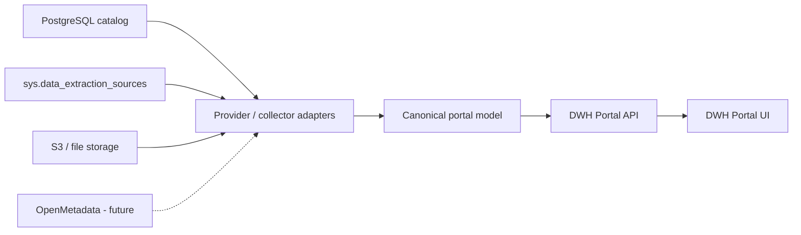
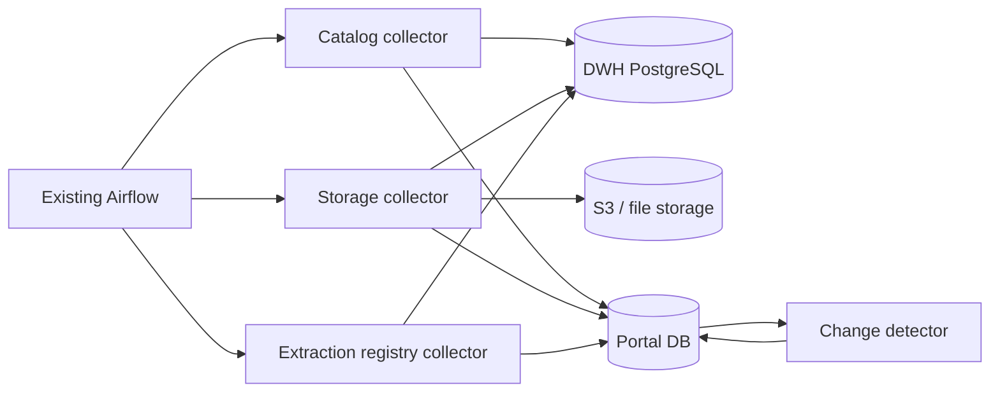
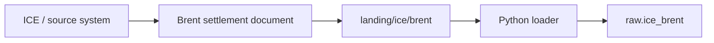
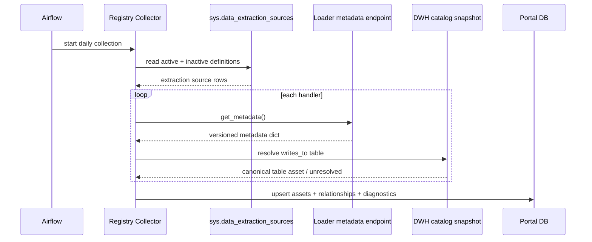
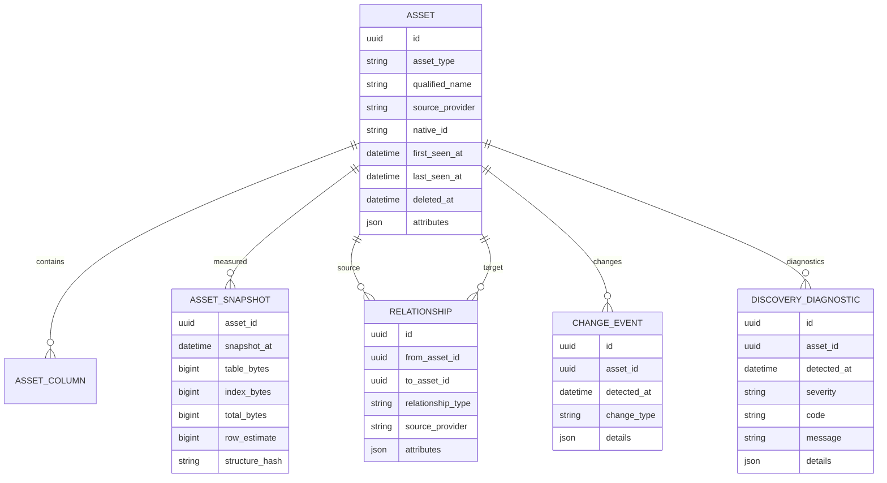
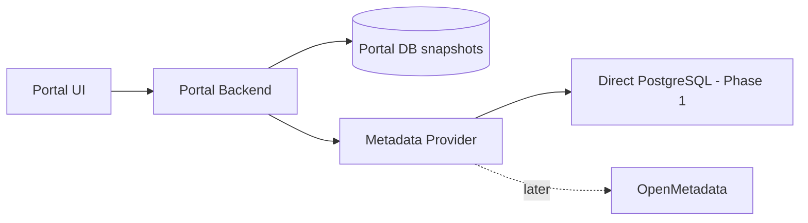

# ADR-002: MVP metadata catalog and source-to-DWH lineage

- **Status:** Proposed for MVP
- **Date:** 2026-09-06
- **Scope:** DWH Portal, Phase 1
- **Decision type:** Architecture / metadata / lineage

## 1. Context

The DWH already contains useful metadata, but there is no complete metadata platform or automated lineage layer yet.

Available sources of truth today:

1. PostgreSQL system catalog and comments for database objects.
2. `sys.data_extraction_sources` as the root registry for ETL ingestion definitions.
3. `sys.data_source_items` as the referenced business/source-system registry.
4. `sys.data_load_schedules` as the referenced load schedule registry.
5. File storage described by `storage_options`.
6. Loader implementations described by `load_options`.

OpenMetadata is a planned future metadata platform, but MVP development must not depend on its deployment.

The MVP must support:

- browsing DWH objects;
- filtering and search;
- storage usage and historical snapshots;
- source-to-DWH lineage;
- detection of added, removed and structurally changed database objects;
- a stable Python backend that can later use OpenMetadata as a provider.

The following are explicitly postponed to Phase 2:

- AI dialogue;
- database usage/activity analytics from query logs.

## 2. Existing ETL root entity

The root ingestion registry is `sys.data_extraction_sources`.

```sql
CREATE TABLE sys.data_extraction_sources (
    id uuid DEFAULT gen_random_uuid() NOT NULL,
    name varchar NULL,
    descr varchar NULL,
    access_level int4 NULL,
    is_active bool NULL,
    extract_source_type_id int4 NULL,
    extract_options jsonb NULL,
    storage_options jsonb NULL,
    load_options jsonb NULL,
    load_schedule_id uuid NULL,
    data_source_id uuid NULL,
    tags text NULL,
    parent_id uuid NULL,
    comment varchar NULL,
    CONSTRAINT data_extraction_sources_pkey2 PRIMARY KEY (id),
    CONSTRAINT data_extraction_sources_data_source_fk
        FOREIGN KEY (data_source_id) REFERENCES sys.data_source_items(id),
    CONSTRAINT data_extraction_sources_parent_fk
        FOREIGN KEY (parent_id) REFERENCES sys.data_extraction_sources(id),
    CONSTRAINT data_extraction_sources_schedule_fk
        FOREIGN KEY (load_schedule_id) REFERENCES sys.data_load_schedules(id)
);
```

For the current MVP, supported extraction is primarily email:

```text
extract_source_type_id = 1
extract_options         = ExtractEmailOptions
storage_options         = ExtractStorageOptions
load_options            = ExtractLoadOptions
```

`load_options.handlers[]` currently supports:

- `PythonV0`;
- `Python`;
- `RestApi`.

## 3. Decision

### 3.1 DWH Portal owns a canonical metadata model

The portal backend will expose its own stable domain model. It will not expose PostgreSQL catalog rows, ETL JSON structures, or future OpenMetadata entities directly to the frontend.



The canonical model is intentionally smaller than OpenMetadata and specific enough for the portal product.

### 3.2 Metadata collection is snapshot-based

The UI must not execute expensive metadata/statistics queries against the DWH on page load.

Collectors run periodically, initially once per day, and persist normalized snapshots in the Portal DB.



### 3.3 Source-to-DWH lineage is reconstructed from the ETL registry

The first supported lineage chain is:

```text
Data source
  -> extraction source / logical document
  -> storage location
  -> load handler/process
  -> DWH table
```

Example:



The graph is allowed to be incomplete. Missing target metadata must not invalidate the entire source definition.

## 4. Canonical domain model

### 4.1 Asset

```text
Asset
- id: UUID                         # portal identity
- asset_type: enum
- qualified_name: string
- name: string
- description: string | null
- source_provider: string          # postgres, extraction_registry, s3, openmetadata...
- native_id: string | null         # pg OID, registry UUID, OM ID, etc.
- first_seen_at: datetime
- last_seen_at: datetime
- deleted_at: datetime | null
- attributes: JSON                 # provider-specific non-core metadata
```

Initial `asset_type` values:

```text
DATABASE
SCHEMA
TABLE
VIEW
MATERIALIZED_VIEW
DATA_SOURCE
EXTRACTION_SOURCE
STORAGE_LOCATION
PROCESS
```

### 4.2 Relationship

```text
Relationship
- id: UUID
- from_asset_id: UUID
- to_asset_id: UUID
- relationship_type: enum
- source_provider: string
- native_id: string | null
- attributes: JSON
```

Initial relationship types:

```text
CONTAINS
BELONGS_TO
EXTRACTS_TO
READS_FROM
WRITES_TO
DERIVED_FROM
PARENT_OF
```

Only data-flow relationships (`EXTRACTS_TO`, `READS_FROM`, `WRITES_TO`, `DERIVED_FROM`) are considered lineage edges.

`PARENT_OF` is structural metadata and is used for `sys.data_extraction_sources.parent_id`.

## 5. Mapping `sys.data_extraction_sources`

| Registry field | Canonical representation |
|---|---|
| `id` | `EXTRACTION_SOURCE.native_id` |
| `name` | `EXTRACTION_SOURCE.name` |
| `descr` | `EXTRACTION_SOURCE.description` |
| `access_level` | asset attribute |
| `is_active` | asset attribute |
| `extract_source_type_id` | asset attribute + extractor dispatch key |
| `extract_options` | parsed source-specific attributes |
| `storage_options` | materialized as `STORAGE_LOCATION` where possible |
| `load_options` | one or more `PROCESS` assets and target discovery |
| `load_schedule_id` | process/source attribute |
| `data_source_id` | relationship to `DATA_SOURCE` |
| `tags` | normalized tags in attributes for MVP |
| `parent_id` | `PARENT_OF` relationship |
| `comment` | secondary human-readable annotation |

## 6. Current option contracts

### 6.1 Email extraction

For `extract_source_type_id = 1`, `extract_options` is interpreted as `ExtractEmailOptions`:

```text
attachment_patterns
subject_patterns
```

The MVP treats one `data_extraction_sources` row as one logical extraction source/document definition, not as one runtime email attachment.

Runtime files are not individual catalog assets in Phase 1.

### 6.2 Storage

`storage_options` is interpreted as `ExtractStorageOptions`.

The canonical storage asset represents the logical landing/archive location described by:

```text
path
inbox_subfolder_template
archive_subfolder_template
filename_template
need_to_unpack
comment
```

Secrets, credentials and host-specific environment details are not copied into the Portal DB.

### 6.3 Load handlers

`ExtractLoadOptions.handlers[]` is dispatched by `handler_type`:

```text
PythonV0 -> LoadPythonHandlerOption
Python   -> LoadPythonExtendedHandlerOption
RestApi  -> LoadRestApiHandlerOption
```

Each handler becomes a canonical `PROCESS` asset.

## 7. Loader metadata contract

### 7.1 Design goal

Lineage discovery must not depend on executing the loader itself.

Metadata discovery must be:

- side-effect free;
- fast;
- deterministic for a given deployed version;
- callable without loading business data;
- independent of runtime payloads whenever possible.

### 7.2 Versioned metadata payload

All loader types must expose the same logical metadata payload.

Minimum MVP contract:

```python
{
    "schema_version": "1.0",
    "name": "ice_brent_loader",
    "description": "Loads ICE Brent settlement data",
    "writes_to": [
        {
            "type": "table",
            "database": "dwh",
            "schema": "raw",
            "name": "ice_brent"
        }
    ]
}
```

Optional fields reserved from the start:

```python
{
    "reads_from": [],
    "writes_to": [],
    "depends_on": [],
    "tags": [],
    "attributes": {}
}
```

`writes_to` is required for a lineage-enabled loader. Multiple targets are supported.

### 7.3 Target reference

MVP target reference:

```python
{
    "type": "table",
    "database": "dwh",
    "schema": "raw",
    "name": "ice_brent"
}
```

The collector resolves this reference against the DWH catalog snapshot.

A target that cannot be resolved is stored as an unresolved lineage reference and reported diagnostically; the collector run does not fail globally.

## 8. Python handler discovery

### 8.1 Module identity

`LoadPythonHandlerOption.module` and `LoadPythonExtendedHandlerOption.module` are treated as the full import path of a Python module.

Example:

```text
company_dwh.loaders.market_data.ice_brent
```

### 8.2 Required metadata entry point

For MVP, the module itself must expose a module-level function:

```python
def get_metadata() -> dict:
    ...
```

Example:

```python
def get_metadata() -> dict:
    return {
        "schema_version": "1.0",
        "name": "ice_brent_loader",
        "description": "Loads ICE Brent settlement data",
        "writes_to": [
            {
                "type": "table",
                "database": "dwh",
                "schema": "raw",
                "name": "ice_brent",
            }
        ],
    }
```

### 8.3 Why module-level `get_metadata()`

The MVP deliberately does not instantiate the runtime loader class and does not call `entry_point` for metadata discovery.

This avoids:

- loader constructor side effects;
- dependency on runtime context;
- accidental writes during catalog collection;
- coupling metadata collection to changing loader class hierarchies.

`entry_point` remains execution metadata, not metadata-discovery metadata.

### 8.4 PythonV0 and Python

Both `PythonV0` and `Python` use the same metadata discovery convention.

The difference between legacy and extended runtime handlers must not leak into the canonical lineage model.

If a legacy module does not implement `get_metadata()`, the process is imported but marked:

```text
metadata_status = MISSING
lineage_status  = UNRESOLVED
```

The ETL job itself remains unaffected.

## 9. REST handler discovery

### 9.1 MVP convention

The existing runtime option is:

```text
connection_id
url_path
method
payload
query_string
headers
...
```

To avoid changing the existing configuration immediately, MVP metadata discovery uses the convention:

```text
GET {resolved_runtime_url_path}/metadata
```

Example:

```text
runtime:  POST https://loader.internal/api/v1/ice/brent
metadata: GET  https://loader.internal/api/v1/ice/brent/metadata
```

The response follows the same versioned metadata contract as Python `get_metadata()`.

### 9.2 Future override

If the convention proves insufficient, add an optional backward-compatible field:

```python
metadata_url_path: str | None = None
```

When provided, it overrides the `/metadata` convention.

This field is intentionally not required for MVP.

### 9.3 Safety

Metadata discovery calls:

- use `GET` regardless of the runtime method;
- never send the runtime payload;
- must not trigger data loading;
- use a short dedicated timeout;
- apply a small retry policy;
- record failures as diagnostics rather than breaking the complete catalog collection.

## 10. Collector flow



## 11. Portal persistence

Minimum persistence model:



## 12. Identity and idempotency

Collectors must be safe to run repeatedly.

Canonical identities:

- PostgreSQL database asset: provider + connection identity + database name;
- PostgreSQL schema asset: database asset + schema name;
- PostgreSQL table asset: schema asset + object name;
- extraction source: `sys.data_extraction_sources.id`;
- data source: `sys.data_source_items.id`;
- process: extraction source ID + handler ordinal/stable handler key;
- storage location: normalized storage descriptor;
- future OpenMetadata asset: OpenMetadata entity ID mapped to canonical asset.

No collector creates a new canonical asset merely because a display name changes.

## 13. Object-change detection

Phase 1 tracks:

```text
ADDED
REMOVED
RENAMED
STRUCTURE_CHANGED
DESCRIPTION_CHANGED
```

For PostgreSQL tables/views, a normalized structure representation is hashed:

```text
object type
columns in ordinal order
column type
nullable
PK/FK/unique constraints as selected for MVP
```

A hash mismatch triggers detailed diff generation.

Within the same PostgreSQL database lifecycle, native OID can be used as supporting evidence for rename detection. OID is not treated as globally stable across restore/migration.

## 14. Failure handling

Failures are localized.

Examples:

- Python module cannot be imported -> diagnostic on that process;
- `get_metadata()` missing -> process visible, lineage unresolved;
- malformed metadata payload -> diagnostic, no edge created;
- REST metadata endpoint unavailable -> diagnostic, previous valid lineage retained until stale policy says otherwise;
- target table not found -> unresolved target diagnostic;
- S3 unavailable -> storage snapshot marked failed, catalog snapshot can still succeed.

The daily collection run should produce a completeness summary rather than an all-or-nothing result.

## 15. Security

MVP requirements:

- DWH collector credentials are read-only;
- loader metadata discovery must not execute the loader;
- metadata payload must not contain credentials or secrets;
- runtime HTTP headers/payload values are not persisted unless explicitly whitelisted;
- `access_level` is retained as metadata and can later participate in portal authorization;
- the Portal DB is not a secret store.

## 16. API impact

The frontend reads only the DWH Portal API.

Minimum Phase 1 endpoints:

```text
GET /api/v1/overview
GET /api/v1/assets
GET /api/v1/assets/{asset_id}
GET /api/v1/assets/{asset_id}/columns
GET /api/v1/assets/{asset_id}/lineage
GET /api/v1/storage
GET /api/v1/storage/history
GET /api/v1/changes
GET /api/v1/changes/{change_id}
GET /api/v1/collection-status
```

The API contract must not expose provider-specific JSON schemas as its primary model.

## 17. OpenMetadata integration later

OpenMetadata is integrated behind provider boundaries.



Expected long-term split:

- OpenMetadata: authoritative catalog, descriptions, governance, standardized lineage;
- Portal DB: snapshots, historical storage statistics, change history, UI-specific aggregates;
- DWH/S3 direct providers: live or source-specific operations where appropriate;
- Portal backend: stable product API and composition layer.

## 18. Consequences

### Positive

- MVP can start immediately without OpenMetadata.
- Loader runtime behavior is not coupled to metadata collection.
- Python and REST loaders expose one logical metadata contract.
- Source-to-DWH lineage can be progressively completed.
- Daily snapshots reduce DWH load and provide historical trends naturally.
- Frontend survives future migration to OpenMetadata unchanged.

### Negative / cost

- A small canonical model and Portal DB must be maintained.
- Loader modules/services need to implement metadata discovery.
- Incomplete or outdated metadata contracts must be diagnosed and governed.
- There is temporary duplication between direct DWH metadata and future OpenMetadata catalog content.

## 19. MVP implementation order

1. Portal DB schema and canonical models.
2. PostgreSQL catalog collector.
3. Object list + object card API/UI.
4. Storage snapshot collector.
5. `sys.data_extraction_sources` parser.
6. Python `get_metadata()` contract and resolver.
7. REST `/metadata` convention and resolver.
8. Canonical lineage graph persistence.
9. Lineage UI.
10. Object-change detection and Changes UI.
11. Collector diagnostics and hardening.
12. OpenMetadata provider spike after MVP value is demonstrated.

## 20. Deferred decisions

Not required to start MVP:

- exact OpenMetadata entity mapping;
- column-level lineage;
- AI tool contract;
- query-log/usage model;
- general metadata contract for non-table targets;
- first-class representation of every runtime file;
- custom metadata endpoint override for REST handlers;
- ownership/glossary/governance workflow.
