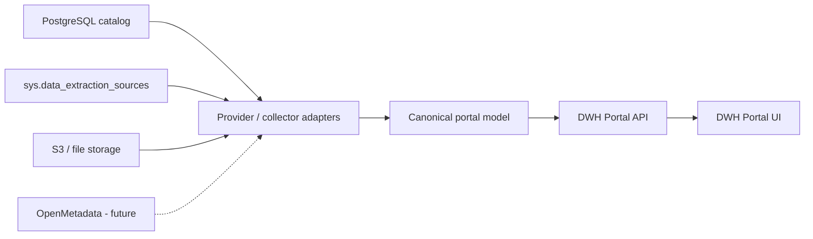
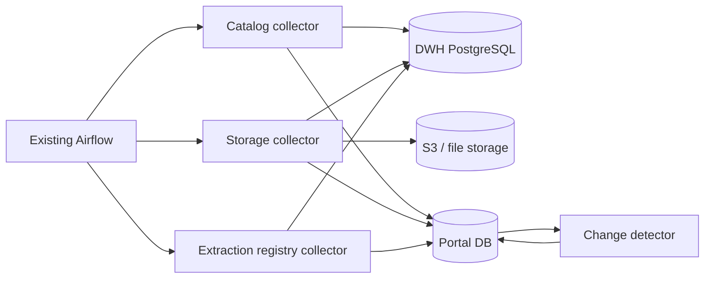
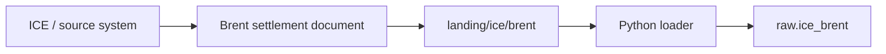
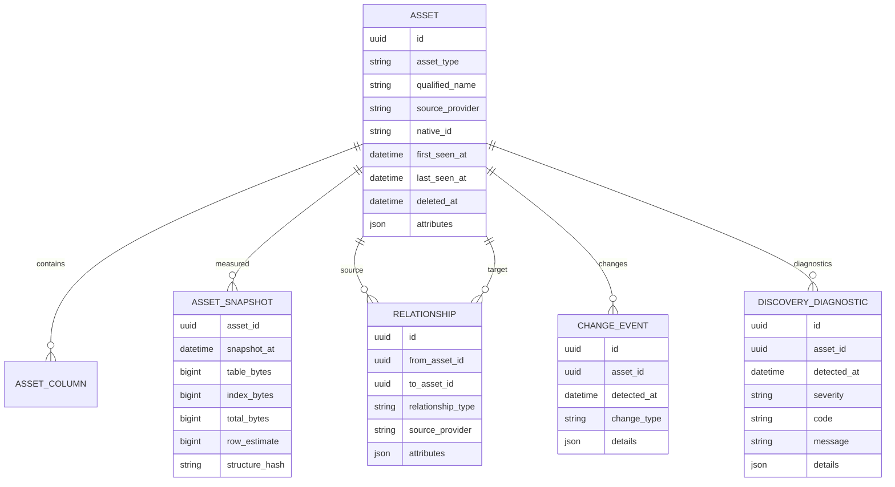
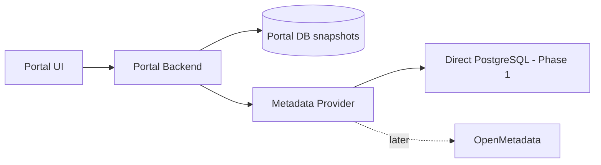

# ADR-002: MVP metadata catalog and source-to-DWH lineage

## Status

Accepted

- **Date:** 2026-09-06
- **Updated:** 2026-10-24
- **Scope:** DWH Portal, Phase 1
- **Decision type:** Architecture / metadata / lineage

## Context

Документ фиксирует архитектурное решение и направление развития, а не отчёт
о готовности функций. Текущий поведенческий контракт находится в
`openspec/specs/catalog/spec.md` и `openspec/specs/ingestion/spec.md`.
Получение Python lineage через AST реализовано; подключение discovery через
`get_metadata(config)` в основной pipeline, OpenLineage receiver и отдельная
модель выполнений относятся к последующим изменениям и требуют согласования
со спецификациями до реализации.

В DWH уже есть полезные метаданные, но полноценной платформы метаданных и
автоматизированного слоя lineage пока нет.

Актуальные источники истины:

1. Системный каталог PostgreSQL и комментарии к объектам БД.
2. `sys.data_extraction_sources` — корневой реестр определений ETL-ingestion.
3. `sys.data_source_items` — реестр бизнес-/source-систем.
4. `sys.data_load_schedules` — реестр расписаний загрузки.
5. Файловое хранилище, описываемое `storage_options`.
6. Реализации загрузчиков, описываемые `load_options`.

DWH Portal — единая точка входа к каталогу, администрированию ingestion и
части мониторинга. Существующий metadata-driven ingestion registry остаётся
рабочим механизмом до появления полноценной платформы данных. Портал должен
давать стабильный минимальный каталог без ожидания этой платформы.

OpenMetadata или аналог рассматривается как возможная будущая платформа.
Срок и сам факт миграции не определены; она не является условием развития
портала. Собственные UI и product API сохраняют самостоятельную ценность.

MVP должен поддерживать:

- просмотр объектов DWH;
- фильтрацию и поиск;
- использование хранилища и исторические снимки;
- логическую схему связей доступных источников с таблицами и views;
- переход от источника к конкретным загрузкам и записям `sys.log_files`;
- обнаружение добавленных, удалённых и структурно изменённых объектов БД;
- стабильный Python-backend, который позже сможет использовать OpenMetadata
  как provider.

Явно отложено на Phase 2:

- AI-диалог;
- аналитика пользовательской активности на основе `pg_audit` — независимое
  направление, без зависимости от OpenLineage или будущей платформы метаданных.

## 2. Существующая корневая сущность ETL

Корневой реестр ingestion — `sys.data_extraction_sources`.

```sql
CREATE TABLE sys.data_extraction_sources (
    id uuid DEFAULT gen_random_uuid() NOT NULL,
    name varchar NULL,
    descr varchar NULL,
    access_level int4 NULL,
    is_active bool NULL,
    extract_source_type_id int4 NULL,
    extract_options jsonb NULL,
    storage_options jsonb NULL,
    load_options jsonb NULL,
    load_schedule_id uuid NULL,
    data_source_id uuid NULL,
    tags text NULL,
    parent_id uuid NULL,
    comment varchar NULL,
    CONSTRAINT data_extraction_sources_pkey2 PRIMARY KEY (id),
    CONSTRAINT data_extraction_sources_data_source_fk
        FOREIGN KEY (data_source_id) REFERENCES sys.data_source_items(id),
    CONSTRAINT data_extraction_sources_parent_fk
        FOREIGN KEY (parent_id) REFERENCES sys.data_extraction_sources(id),
    CONSTRAINT data_extraction_sources_schedule_fk
        FOREIGN KEY (load_schedule_id) REFERENCES sys.data_load_schedules(id)
);
```

Для текущего MVP поддерживаемая extraction в основном email:

```text
extract_source_type_id = 1
extract_options         = ExtractEmailOptions
storage_options         = ExtractStorageOptions
load_options            = ExtractLoadOptions
```

`load_options.handlers[]` сейчас поддерживает:

- `PythonV0`;
- `Python`;
- `RestApi`.

## Decision

### 3.1 DWH Portal владеет канонической моделью метаданных

Backend портала экспонирует собственную стабильную доменную модель. Он не
отдаёт фронтенду напрямую строки каталога PostgreSQL, ETL JSON-структуры или
будущие сущности OpenMetadata.



Каноническая модель намеренно уже OpenMetadata и достаточно специфична для
продукта портала.

### 3.2 Сбор метаданных — на основе снимков

UI не должен выполнять тяжёлые запросы метаданных/статистики к DWH при загрузке
страницы.

Collectors каталога и размеров запускаются периодически, изначально раз в
сутки, и сохраняют нормализованные снимки в Portal DB. Это правило относится
к каталожной read-модели, а не ко всем операционным данным: `sys.log_files`
читается отдельно и постранично; будущие события выполнений принимаются
независимо от снимочного сбора.



### 3.3 Lineage source-to-DWH восстанавливается из реестра ETL

Первая поддерживаемая цепочка lineage:

```text
Data source
  -> extraction source / logical document
  -> storage location
  -> load handler/process
  -> DWH table
```

Пример:



Граф может быть неполным. Отсутствие метаданных о целевом объекте не должно
инвалидировать всё определение источника.

### 3.4 Логическая схема и конкретные выполнения

| Представление | Содержание | Источники |
|---|---|---|
| Логическая схема потока | Логические datasets, handlers/processes, связи чтения/записи и SQL-зависимости; не привязана к конкретному дню | Registry, системный каталог, AST, явный metadata-контракт |
| Конкретное выполнение | Запуск процесса, время, статус, сообщённые входы/выходы и связанные файлы | Журнал загрузок, сведения Airflow; в дальнейшем OpenLineage-события |

`Asset` / `Relationship` описывают логическую схему. Дата и `runId` не входят
в identity логической таблицы или handler. История выполнений хранится
отдельно и ссылается на стабильные логические идентификаторы.

Схема не является объединением всех исторических запусков. Отсутствие ребра
в одном запуске не означает его удаления из схемы; историческое выполнение
сохраняет свои связи после изменения схемы. Наблюдения могут подтверждать
или обнаруживать зависимости, но не подменяют объявленную схему молча.

На первом этапе проваливание реализуется списками загрузок и деталями;
отдельная визуализация графа каждого запуска не является условием MVP.

### 3.5 Источники логической схемы

AST и `get_metadata(config)` — поддерживаемые дополняющие способы discovery.
Оба доступны до первого запуска загрузки. AST не объявляется исключительно
временным fallback и не имеет запланированного срока удаления.

AST анализирует поддерживаемые конструкции без импорта loader-модулей;
явный metadata-контракт возвращает зависимости для конфигурации handler.
Для каждого свидетельства сохраняется происхождение и область применимости
(handler/configuration, версия кода или файл/конструкция, где доступны).
Несколько свидетельств одной связи не должны теряться при объединении.

Детерминированность анализа не равна полноте результата. Неоднозначные цели
диагностируются. Расхождения AST, явного контракта и наблюдений выполнения
не разрешаются молчаливым перезаписыванием или правилом «последний победил».
Конкретная политика разрешения конфликтов определяется в implementation change.

## 4. Каноническая доменная модель

### 4.1 Asset

```text
Asset
- id: UUID                         # portal identity
- asset_type: enum
- qualified_name: string
- name: string
- description: string | null
- source_provider: string          # postgres, extraction_registry, s3, openmetadata...
- native_id: string | null         # pg OID, registry UUID, OM ID, etc.
- first_seen_at: datetime
- last_seen_at: datetime
- deleted_at: datetime | null
- attributes: JSON                 # provider-specific non-core metadata
```

Начальные значения `asset_type`:

```text
DATABASE
SCHEMA
TABLE
VIEW
MATERIALIZED_VIEW
DATA_SOURCE
EXTRACTION_SOURCE
STORAGE_LOCATION
PROCESS
```

### 4.2 Relationship

```text
Relationship
- id: UUID
- from_asset_id: UUID
- to_asset_id: UUID
- relationship_type: enum
- source_provider: string
- native_id: string | null
- attributes: JSON
```

Начальные типы связей:

```text
CONTAINS
BELONGS_TO
EXTRACTS_TO
READS_FROM
WRITES_TO
DERIVED_FROM
PARENT_OF
```

Только data-flow связи (`EXTRACTS_TO`, `READS_FROM`, `WRITES_TO`,
`DERIVED_FROM`) считаются рёбрами lineage.

`PARENT_OF` — структурные метаданные; используются для
`sys.data_extraction_sources.parent_id`.

## 5. Маппинг `sys.data_extraction_sources`

| Поле реестра | Каноническое представление |
|---|---|
| `id` | `EXTRACTION_SOURCE.native_id` |
| `name` | `EXTRACTION_SOURCE.name` |
| `descr` | `EXTRACTION_SOURCE.description` |
| `access_level` | атрибут asset |
| `is_active` | атрибут asset |
| `extract_source_type_id` | атрибут asset + ключ диспетчеризации extractor |
| `extract_options` | разобранные source-specific атрибуты |
| `storage_options` | материализуются как `STORAGE_LOCATION`, где возможно |
| `load_options` | один или несколько `PROCESS` assets и обнаружение целей |
| `load_schedule_id` | атрибут process/source |
| `data_source_id` | связь с `DATA_SOURCE` |
| `tags` | нормализованные теги в attributes для MVP |
| `parent_id` | связь `PARENT_OF` |
| `comment` | вторичная человекочитаемая аннотация |

## 6. Текущие контракты options

### 6.1 Email extraction

Для `extract_source_type_id = 1` поле `extract_options` интерпретируется как
`ExtractEmailOptions`:

```text
attachment_patterns
subject_patterns
```

MVP считает одну строку `data_extraction_sources` одним логическим определением
extraction source / документа, а не одним runtime email-вложением.

Runtime-файлы не являются отдельными catalog assets в Phase 1.

### 6.2 Storage

`storage_options` интерпретируется как `ExtractStorageOptions`.

Канонический storage asset представляет логическое landing/archive-расположение,
описанное полями:

```text
path
inbox_subfolder_template
archive_subfolder_template
filename_template
need_to_unpack
comment
```

Секреты, credentials и host-specific детали окружения в Portal DB не
копируются.

### 6.3 Load handlers

`ExtractLoadOptions.handlers[]` диспетчеризуется по `handler_type`:

```text
PythonV0 -> LoadPythonHandlerOption
Python   -> LoadPythonExtendedHandlerOption
RestApi  -> LoadRestApiHandlerOption
```

Каждый handler становится каноническим `PROCESS` asset.

## 7. Контракт метаданных загрузчика

### 7.1 Цель проектирования

Обнаружение lineage не должно зависеть от выполнения самого загрузчика.

Discovery метаданных должен быть:

- без побочных эффектов;
- быстрым;
- детерминированным для данной развёрнутой версии;
- вызываемым без загрузки бизнес-данных;
- по возможности независимым от runtime payloads.

### 7.2 Версионированный metadata payload

Явные metadata-контракты Python и REST используют один логический payload.
AST-адаптер нормализует найденные зависимости к той же продуктовой модели;
наличие `get_metadata()` у каждого существующего loader не требуется.

Минимальный payload явного контракта:

```python
{
    "schema_version": "1.0",
    "name": "ice_brent_loader",
    "description": "Loads ICE Brent settlement data",
    "writes_to": [
        {
            "type": "table",
            "database": "dwh",
            "schema": "raw",
            "name": "ice_brent"
        }
    ]
}
```

Опциональные поля зарезервированы с самого начала:

```python
{
    "reads_from": [],
    "writes_to": [],
    "depends_on": [],
    "tags": [],
    "attributes": {}
}
```

`writes_to` обязателен для загрузчика с поддержкой lineage. Несколько целей
поддерживаются.

### 7.3 Ссылка на цель

MVP-ссылка на цель:

```python
{
    "type": "table",
    "database": "dwh",
    "schema": "raw",
    "name": "ice_brent"
}
```

Collector разрешает эту ссылку относительно снимка каталога DWH.

Неразрешённая цель сохраняется как unresolved lineage reference и
диагностируется; прогон collector не падает глобально.

## 8. Discovery для Python handler

### 8.1 Идентичность модуля

`LoadPythonHandlerOption.module` и `LoadPythonExtendedHandlerOption.module`
трактуются как полный import path Python-модуля.

Пример:

```text
company_dwh.loaders.market_data.ice_brent
```

### 8.2 AST и явный metadata-контракт

Текущий `python_modules` adapter получает зависимости синтаксическим разбором
исходников. Он не импортирует loader и не вызывает `get_metadata()`.
Это поддерживаемый способ discovery для известных конструкций кода.

Дополнительный явный способ — module-level `get_metadata()`, а для
конфигурационно-зависимых целей — `get_metadata(config)`. Последняя форма
задаёт направление контракта, а не уже реализованную сигнатуру resolver.
Точная схема config и вызова уточняется при реализации.

Пример конфигурационно-независимого контракта:

```python
def get_metadata() -> dict:
    return {
        "schema_version": "1.0",
        "name": "ice_brent_loader",
        "writes_to": [
            {
                "type": "table",
                "database": "dwh",
                "schema": "raw",
                "name": "ice_brent",
            }
        ],
    }
```

### 8.3 Независимость от выполнения загрузки

`get_metadata(config)` вызывается отдельно от `load_file()` и до первой
загрузки. Он не запускает ETL, не записывает данные и не требует фактического
входного файла. Импорт модуля и metadata-метод должны быть безопасны и не
иметь побочных эффектов. Сбор не вызывает runtime entry point и конструктор
loader ради получения метаданных.

При одинаковых версии кода и конфигурации результат должен быть воспроизводим.
Если цель зависит от неизвестного runtime-параметра, контракт явно сообщает
об ограничении или описывает допустимые цели; он не выдумывает одну таблицу.

Отличие AST — отсутствие исполнения Python-кода и необходимости менять loader.
Отличие явного контракта — прямое описание зависимостей, в том числе зависящих
от конфигурации. Ни один способ сам по себе не гарантирует полноту.

### 8.4 PythonV0 и Python

Оба вида handler могут использовать AST и явный контракт. Различие runtime
handlers не протекает в каноническую модель lineage.

Registry создаёт PROCESS без импорта loader; в текущем pipeline Python
discovery откладывается до `python_modules`. Отсутствие `get_metadata()` не
является ошибкой, если зависимости получены другим способом. Если ни один
настроенный способ не определил цели, PROCESS остаётся видимым с диагностикой
и unresolved/partial lineage; сам ETL-job не затрагивается.

## 9. Discovery для REST handler

### 9.1 Конвенция MVP

Существующая runtime option:

```text
connection_id
url_path
method
payload
query_string
headers
...
```

Чтобы не менять существующую конфигурацию сразу, discovery метаданных в MVP
использует конвенцию:

```text
GET {resolved_runtime_url_path}/metadata
```

Пример:

```text
runtime:  POST https://loader.internal/api/v1/ice/brent
metadata: GET  https://loader.internal/api/v1/ice/brent/metadata
```

Ответ следует тому же версионированному контракту метаданных, что и Python
`get_metadata()`.

### 9.2 Будущий override

Если конвенции окажется недостаточно, добавить опциональное
обратно-совместимое поле:

```python
metadata_url_path: str | None = None
```

Если задано, оно перекрывает конвенцию `/metadata`.

Для MVP это поле намеренно не требуется.

### 9.3 Безопасность

Вызовы discovery метаданных:

- используют `GET` независимо от runtime method;
- никогда не отправляют runtime payload;
- не должны запускать загрузку данных;
- используют короткий отдельный timeout;
- применяют небольшую retry policy;
- фиксируют сбои как diagnostics, а не ломают полный сбор каталога.

## 10. Поток collector

Текущий сбор: каталог PostgreSQL и размеры → registry → независимые lineage
adapters (`postgres_sql`, `python_modules`, `airflow_dags`) → изменения.
Registry создаёт Python PROCESS без исполнения loader; `python_modules`
дописывает цели из AST отдельного корня исходников. REST metadata resolver
читает `/metadata` без запуска загрузки.

При добавлении явного Python metadata-контракта он станет ещё одним способом
discovery логической схемы. Это не требует загрузки бизнес-данных.

Будущий OpenLineage receiver принимает события отдельно от ежедневного сбора.
Он не заменяет collector полного каталога, определения registry или metadata
discovery до первого запуска.

## 11. Persistence портала

Минимальная модель persistence:



## 12. Идентичность и идемпотентность

Collectors должны быть безопасны для повторного запуска.

Канонические идентичности:

- PostgreSQL database asset: provider + connection identity + имя БД;
- PostgreSQL schema asset: database asset + имя схемы;
- PostgreSQL table asset: schema asset + имя объекта;
- extraction source: `sys.data_extraction_sources.id`;
- data source: `sys.data_source_items.id`;
- process: ID extraction source + ordinal handler / стабильный ключ handler;
- storage location: нормализованный дескриптор хранилища;
- будущий OpenMetadata asset: ID сущности OpenMetadata, отображённый на
  канонический asset.

Ни один collector не создаёт новый канонический asset только из-за смены
отображаемого имени.

## 13. Обнаружение изменений объектов

Phase 1 отслеживает:

```text
ADDED
REMOVED
RENAMED
STRUCTURE_CHANGED
DESCRIPTION_CHANGED
```

Для таблиц/views PostgreSQL нормализованное представление структуры хешируется:

```text
object type
columns in ordinal order
column type
nullable
PK/FK/unique constraints as selected for MVP
```

Несовпадение хеша запускает генерацию детального diff.

В рамках одного жизненного цикла БД PostgreSQL native OID может использоваться
как вспомогательное свидетельство для обнаружения rename. OID не считается
глобально стабильным после restore/migration.

## 14. Обработка сбоев

Сбои локализуются.

Примеры:

- AST не может определить цель → diagnostic; process остаётся видимым;
- явный контракт недоступен → diagnostic этого способа discovery, остальные
  способы продолжают работать;
- ни один способ не определил цель → process виден, lineage unresolved;
- некорректный metadata payload → diagnostic, ребро не создаётся;
- REST metadata endpoint недоступен → diagnostic, предыдущий валидный lineage
  сохраняется, пока stale policy не скажет иное;
- целевая таблица не найдена → diagnostic unresolved target;
- S3 недоступен → storage snapshot помечен как failed, catalog snapshot всё ещё
  может завершиться успешно.

Ежедневный прогон сбора должен давать сводку полноты, а не результат
«всё или ничего».

## 15. Security

Требования MVP:

- credentials collector к DWH — только read-only;
- discovery метаданных загрузчика не должен выполнять загрузчик;
- metadata payload не должен содержать credentials или secrets;
- runtime HTTP headers/payload не персистятся, если явно не whitelisted;
- `access_level` сохраняется как метаданные и позже может участвовать в
  авторизации портала;
- Portal DB — не хранилище секретов.

## 16. Влияние на API

Фронтенд читает только DWH Portal API.

Минимальные endpoints Phase 1:

```text
GET /api/v1/overview
GET /api/v1/assets
GET /api/v1/assets/{asset_id}
GET /api/v1/assets/{asset_id}/columns
GET /api/v1/assets/{asset_id}/lineage
GET /api/v1/storage
GET /api/v1/storage/history
GET /api/v1/changes
GET /api/v1/changes/{change_id}
GET /api/v1/collection-status
```

Контракт API не должен экспонировать provider-specific JSON-схемы как основную
модель.

## 17. Интеграция OpenMetadata позже

OpenMetadata или аналог может подключаться за границами provider после
проверки покрытия потребностей. Развёртывание платформы не входит в текущий
этап; собственный UI остаётся единой пользовательской точкой входа.



Распределение каталога, профилей размеров и истории изменений между
платформой и Portal DB определяется проверкой её возможностей. Не требуется
заранее поддерживать две авторитетные копии каталога. Registry и специфичные
операционные функции сохраняются там, где платформа их не покрывает.

### 17.1 OpenLineage и переносимость событий — планируемое дополнение

Собственный backend может принимать стандартные OpenLineage RunEvent от
Airflow и loaders без OM. Сохраняется исходный JSON payload, включая eventTime,
eventType, runId, job, inputs/outputs и facets; приёмные атрибуты хранятся
отдельно. Исходные события являются основой повторной обработки; графы и
статусы портала — производными проекциями. Повторы и порядок доставки должны
учитываться; runId не является уникальным идентификатором события.

Dataset `namespace + name` и job `namespace + name` выбираются стабильными;
runId идентифицирует выполнение. Registry source и handler связываются с job
явно. Точные mapping и хранение определяются при реализации, без создания
универсального слоя всех возможных providers заранее.

Чтобы впоследствии отправить прошлые события в OM без конвертации payload,
реальный набор событий проверяется на выбранной версии OM. Настройка
namespace mapping, подготовка каталога, авторизация и replay допустимы;
переписывание исторических JSON не должно быть штатным условием перехода.

Совместимость формата не гарантирует перенос всей истории запусков, графов
отдельных выполнений и custom facets: принимающая платформа может обработать
только часть полей. Собственный архив не удаляется на основании успешного
приёма событий OM. Политика хранения определяется отдельно.

Это решение о направлении развития. В текущем коде receiver и отдельная
модель выполнений отсутствуют и этим ADR не объявляются реализованными.

### 17.2 Порядок замены каталожного backend

1. Выбрать и развернуть версию OM; на реальных объектах проверить каталог,
   views, lineage, размеры и ограничения приёма RunEvent. Зафиксировать,
   какие функции остаются в Portal DB/DWH. Сохранение UI не требует
   копирования всех возможностей интерфейса OM.
2. Настроить соответствие dataset namespaces сервисам OM и существующих
   portal Asset IDs внешним сущностям. Portal UUID и ссылки UI сохраняются;
   OM UUID не подставляется вместо них без mapping. Этот mapping реализуется
   при переходе, а не как универсальная платформа заранее.
3. Наполнить OM каталогом PostgreSQL через его ingestion; добавить недостающие
   source/process metadata и актуальные логические связи из registry,
   AST и явных контрактов через адаптер к API OM. Прямой импорт таблиц
   Portal DB в внутреннюю БД OM не используется. Не все типы источников
   имеют прямой эквивалент в OM; их локальное представление допустимо.
4. Проверить отправку сохранённых OpenLineage payload без конвертации,
   затем организовать replay и переключение новых событий без окна потери.
   Исторические наблюдения не используются как безусловная актуальная схема:
   после replay она сверяется с действующими определениями и зависимостями.
   Архив и графы конкретных выполнений остаются у портала до подтверждения
   полного покрытия принимающей платформой.
5. Подключить OM-provider за существующими сервисами Portal API. Сначала
   сравнить выдачу на контрольных источниках, таблицах и views, затем
   переключить чтение каталога и схемы потока. Сохранить возможность возврата
   к прежнему источнику на период перехода; UI не обращается к OM напрямую.
6. После проверки отключить дублирующий сбор только покрытых метаданных.
   Registry остаётся источником конфигурации ingestion; его администрирование,
   `sys.log_files`, независимый `g_audit` и непокрытые метрики продолжают
   работать через портал. Локальные таблицы удаляются лишь после проверки
   зависимостей и политики хранения, а не при первом успешном чтении OM.

## Consequences

## 18. Consequences

### Положительные

- MVP можно начинать сразу, без OpenMetadata.
- Runtime-поведение загрузчика не связано со сбором метаданных.
- Python и REST loaders отдают один логический контракт метаданных.
- Lineage source-to-DWH можно достраивать постепенно.
- Ежедневные снимки снижают нагрузку на DWH и естественно дают исторические
  тренды.
- Product API изолирует UI от providers; изменения UI при будущей миграции
  минимизируются, но их полное отсутствие не гарантируется.

### Отрицательные / стоимость

- Нужно поддерживать небольшую каноническую модель и Portal DB.
- Поддерживаются AST-правила и явные metadata-контракты; их покрытие и
  расхождения требуют диагностики.
- Неполные или устаревшие контракты метаданных нужно диагностировать и
  управлять.
- Появление платформы потребует проверки mapping и распределения ответственности;
  постоянное дублирование каталогов не является целевой архитектурой.

## 19. Порядок реализации MVP

1. Схема Portal DB и канонические модели.
2. Collector каталога PostgreSQL.
3. API/UI списка объектов и карточки объекта.
4. Collector снимков хранилища.
5. Парсер `sys.data_extraction_sources`.
6. AST discovery Python loaders; явный `get_metadata(config)` как дополнительный
   способ в отдельном implementation change.
7. Конвенция REST `/metadata` и resolver.
8. Persistence канонического графа lineage.
9. UI lineage.
10. Обнаружение изменений объектов и UI Changes.
11. Diagnostics collectors и hardening.
12. По потребности — OpenLineage receiver и проваливание в выполнения.
13. Когда появится основание для миграции — проверка OM или аналога, без
    обязательства внедрить платформу в определённую фазу.

## 20. Отложенные решения

Не требуется, чтобы начать MVP:

- точный маппинг сущностей OpenMetadata;
- column-level lineage;
- контракт AI tools;
- детальная модель независимой аналитики активности на основе `g_audit`;
- общий контракт метаданных для non-table целей;
- first-class представление каждого runtime-файла;
- custom override metadata endpoint для REST handlers;
- ownership/glossary/governance workflow.
