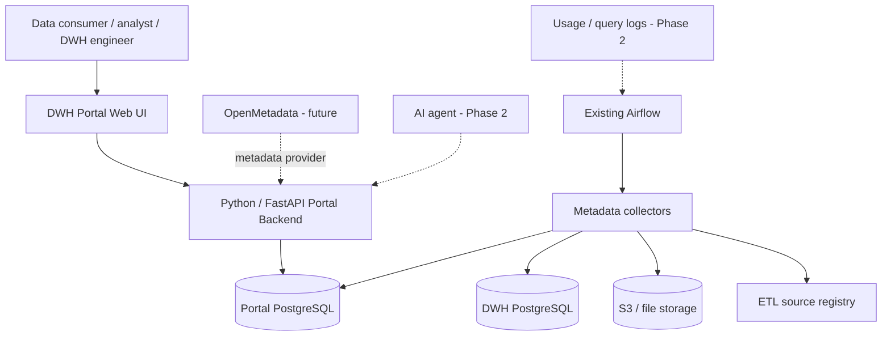
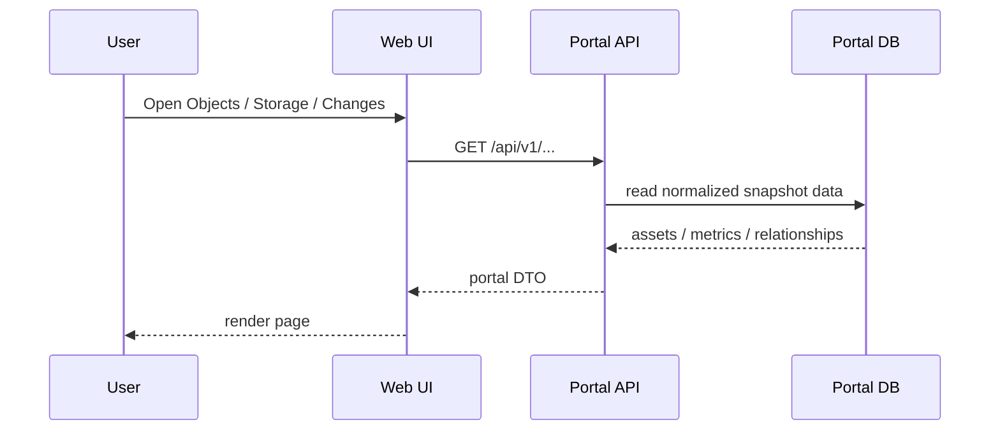
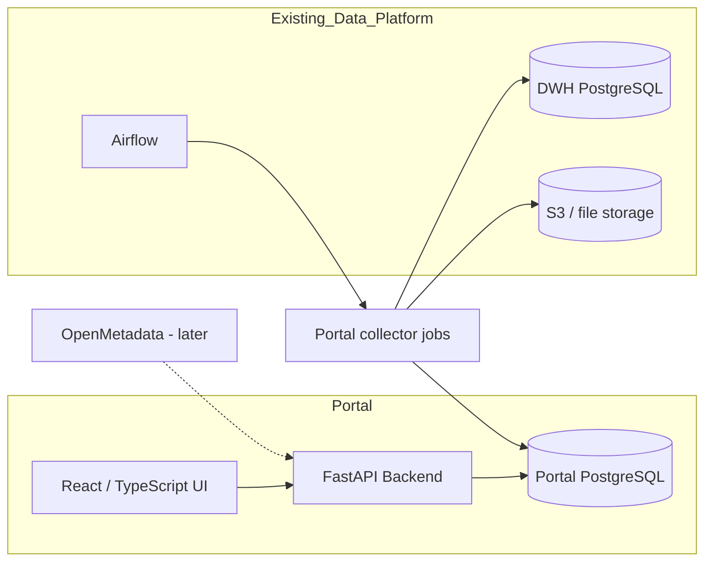
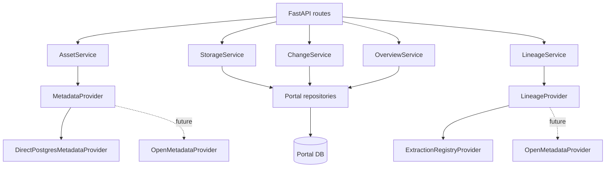
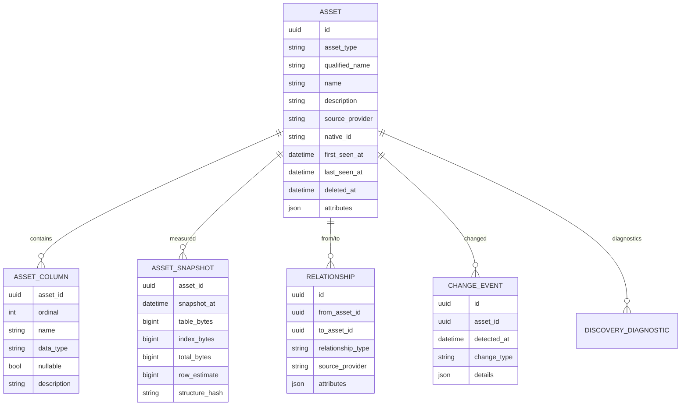
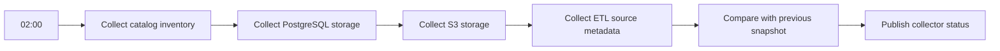
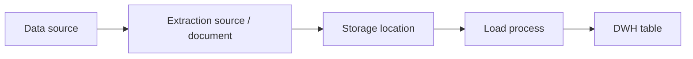
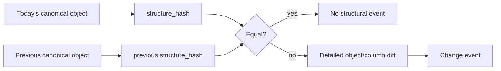
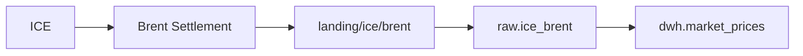
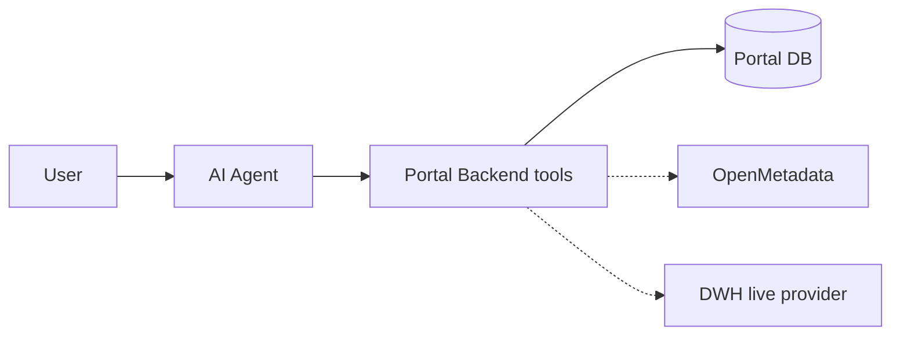

# DWH Portal - Architecture and Design

- **Version:** MVP / Phase 1
- **Date:** 2026-09-06
- **Status:** Initial design

## 1. Purpose

DWH Portal is a user-facing catalog and operational metadata application for discovering DWH assets, understanding their origin and dependencies, monitoring storage footprint, and seeing structural changes over time.

The portal is deliberately separated from OpenMetadata.

OpenMetadata may become a metadata system of record later, but the DWH Portal backend and frontend are long-lived product components.

## 2. MVP scope

### Phase 1

- database/schema/table/view catalog;
- search and filtering;
- object detail page;
- table/column descriptions from PostgreSQL metadata/comments;
- storage size and storage distribution;
- historical storage snapshots;
- source-to-DWH lineage;
- structural object change tracking;
- collector health / freshness status.

### Phase 2

- AI dialogue;
- database usage/activity analytics supplied from query/audit logs;
- OpenMetadata provider and governance integration;
- richer semantic search;
- optional column-level lineage.

## 3. Architectural principles

1. **The browser talks only to the Portal API.**
2. **UI pages do not run metadata scans against the DWH.**
3. **Operational metadata is collected periodically and stored as snapshots.**
4. **Portal API contracts use a canonical product model, not provider-native DTOs.**
5. **OpenMetadata is a replaceable metadata provider, not the frontend backend contract.**
6. **Live DWH/S3 access is reserved for operations that genuinely need live data.**
7. **Collection failures are localized and observable.**

## 4. System context



## 5. Runtime request path

The normal user request path is intentionally short:



No DWH-wide scan is triggered by the page request.

## 6. Deployment view



Recommended deployment boundary:

```text
portal-web        stateless
portal-api        stateless
portal-db         persistent
collector jobs    launched/orchestrated by existing Airflow
```

## 7. Backend component design



### Provider responsibilities

`MetadataProvider`

```text
list_assets()
get_asset()
get_columns()
search_assets()
```

`LineageProvider`

```text
get_relationships()
resolve_process_targets()
```

Collectors are separate from request-time providers because they create persistent snapshots.

## 8. Suggested repository structure

```text
dwh-portal/
├── backend/
│   └── app/
│       ├── api/
│       │   ├── overview.py
│       │   ├── assets.py
│       │   ├── storage.py
│       │   ├── lineage.py
│       │   ├── changes.py
│       │   └── collection_status.py
│       ├── domain/
│       │   ├── asset.py
│       │   ├── relationship.py
│       │   ├── snapshot.py
│       │   ├── change.py
│       │   └── diagnostic.py
│       ├── services/
│       │   ├── asset_service.py
│       │   ├── storage_service.py
│       │   ├── lineage_service.py
│       │   ├── change_service.py
│       │   └── overview_service.py
│       ├── providers/
│       │   ├── metadata/
│       │   │   ├── postgres.py
│       │   │   └── openmetadata.py       # later
│       │   ├── lineage/
│       │   │   ├── extraction_registry.py
│       │   │   └── openmetadata.py       # later
│       │   └── storage/
│       │       ├── postgres.py
│       │       └── s3.py
│       └── repositories/
│           └── portal_db/
├── collectors/
│   ├── catalog/
│   ├── storage/
│   ├── extraction_registry/
│   └── changes/
└── frontend/
```

## 9. Canonical metadata model



## 10. Catalog collection

The PostgreSQL catalog collector reads metadata using a dedicated read-only connection.

Sources include:

```text
pg_database
pg_namespace
pg_class
pg_attribute
pg_description
pg_constraint
pg_indexes / catalog equivalents
```

The collector does not execute full-table `COUNT(*)` scans merely to populate the UI.

For row count, use estimates suitable for catalog purposes.

## 11. Storage collection

### PostgreSQL

Collect at least:

```text
table_bytes
index_bytes
total_bytes
row_estimate
```

Typical source functions/catalog data:

```text
pg_relation_size(...)
pg_indexes_size(...)
pg_total_relation_size(...)
```

### S3 / file storage

Collect logical prefix/storage-location metrics, not one Portal asset per runtime file.

Typical aggregation:

```text
logical storage location
object_count
size_bytes
snapshot_at
```

## 12. Collection schedule

Initial baseline: daily.



The schedule can later be split by metric freshness requirement.

## 13. Source-to-DWH lineage

The first lineage chain comes from `sys.data_extraction_sources` and loader metadata.



For email sources:

```text
extract_source_type_id = 1
extract_options         = ExtractEmailOptions
storage_options         = ExtractStorageOptions
load_options            = ExtractLoadOptions
```

### Python loaders

```text
LoadPythonHandlerOption.module
LoadPythonExtendedHandlerOption.module
```

are treated as full Python module paths.

The module implements:

```python
def get_metadata() -> dict:
    ...
```

Minimum result:

```json
{
  "schema_version": "1.0",
  "name": "ice_brent_loader",
  "writes_to": [
    {
      "type": "table",
      "database": "dwh",
      "schema": "raw",
      "name": "ice_brent"
    }
  ]
}
```

### REST loaders

MVP convention:

```text
Runtime  : <url_path>
Metadata : GET <url_path>/metadata
```

The endpoint returns the same logical metadata contract.

## 14. Change tracking

Phase 1 tracks:

```text
ADDED
REMOVED
RENAMED
STRUCTURE_CHANGED
DESCRIPTION_CHANGED
```

Normalized structure is hashed on each catalog run.



A removed object is soft-deleted in the Portal DB so that historical snapshots and change history remain queryable.

## 15. API design

### Overview

```text
GET /api/v1/overview
```

Returns:

```text
asset counts
storage totals
recent change summary
collector freshness
```

### Assets

```text
GET /api/v1/assets
GET /api/v1/assets/{asset_id}
GET /api/v1/assets/{asset_id}/columns
GET /api/v1/assets/{asset_id}/lineage
```

Filters:

```text
q
database
schema
type
source
status
changed_since
sort
page/page_size
```

### Storage

```text
GET /api/v1/storage
GET /api/v1/storage/history
```

### Changes

```text
GET /api/v1/changes
GET /api/v1/changes/{change_id}
```

### Operations

```text
GET /api/v1/collection-status
```

## 16. UI information architecture

```text
DWH Portal
--------------------------------------------------------
Overview | Objects | Storage | Lineage | Changes

Phase 2:
Overview | Objects | Storage | Usage | Lineage | Changes | Ask AI
```

## 17. UI concept - Overview

Illustrative values only.

```text
+---------------------------------------------------------------+
| DWH Overview                                                   |
+-------------------+--------------------+------------------------+
| Objects           | Total storage      | Changes 24h            |
| 4,812             | 18.7 TB            | 23                     |
| 3,921 tables      | 12.4 TB data       | +7 added               |
|   891 views       |  6.3 TB indexes    | 14 changed / 2 removed |
+-------------------+--------------------+------------------------+

Storage by schema
raw       ####################  7.9 TB
history   ############          4.8 TB
dwh       ##########            3.9 TB
stage     #####                 2.1 TB

Recent changes
+ raw.ice_options
~ dwh.market_prices   + column currency
- stage.old_prices
```

## 18. UI concept - Objects

```text
Objects

[ Search objects.............................................. ]

Database [All v]  Schema [All v]  Type [All v]  Source [All v]
Status   [Active v]

Object                    Type      Size       Rows       Changed
------------------------------------------------------------------
dwh.market_prices         TABLE     128 GB     ~420 M     yesterday
dwh.instruments           TABLE      31 GB      ~82 M     12 Aug
raw.ice_brent             TABLE      84 GB     ~310 M     today
mart.commodity_prices     VIEW        -           -       4 Aug
```

## 19. UI concept - Object detail

```text
dwh.market_prices                                      TABLE

Market prices and settlement values

Database        DWH
Schema          dwh
Size            128 GB
Indexes          31 GB
Rows            ~420 M
Last scan       06 Sep 2026 02:12

[Overview] [Columns] [Lineage] [Storage] [Changes]

Columns
------------------------------------------------------------------
instrument_id       bigint          Instrument identifier
trade_date          date            Trading date
settlement_price    numeric(18,6)   Settlement price
currency            varchar(3)      Currency
```

The same object page should expose source origin rather than forcing a normal user to open OpenMetadata.

## 20. UI concept - Storage

```text
Storage                                            As of 02:15

Total                                                18.7 TB
Data                                                 12.4 TB
Indexes                                               6.3 TB

By schema
------------------------------------------------------------------
raw                                                   7.9 TB
history                                               4.8 TB
dwh                                                   3.9 TB
stage                                                 2.1 TB

Largest objects
------------------------------------------------------------------
history.transactions                                 2.3 TB
raw.trade_events                                     1.7 TB
dwh.fact_sales                                       0.8 TB
```

Historical snapshots enable trend charts without querying live DWH tables at render time.

## 21. UI concept - Lineage



UI requirements:

- upstream/downstream traversal;
- visual distinction between source, storage, process and database assets;
- click-through to object detail;
- unresolved targets shown explicitly, not silently omitted;
- structural relationships visually distinguished from data-flow lineage.

## 22. UI concept - Changes

```text
Changes                                    Period [Last 7 days v]

Added                 Changed                 Removed
  18                      37                       4

06 Sep
------------------------------------------------------------------
+ raw.ice_options
  New table, 14 columns

~ dwh.market_prices
  + settlement_currency varchar(3)

~ dwh.customer
  customer_code varchar(20) -> varchar(50)

- stage.old_ice_prices
```

## 23. Freshness and diagnostics

Every user-facing page that depends on snapshots should expose freshness.

Examples:

```text
Metadata updated: 06 Sep 2026 02:12
Storage updated : 06 Sep 2026 02:17
Lineage updated : 06 Sep 2026 02:19
```

Collector status must distinguish:

```text
SUCCESS
PARTIAL
FAILED
STALE
```

A partial source/loader metadata failure must not hide the rest of the catalog.

## 24. Security

Phase 1 minimum:

- read-only DWH access for collectors;
- no database credentials returned to the frontend;
- no raw Airflow connection secrets persisted in Portal DB;
- no runtime REST payload/headers persisted unless whitelisted;
- `access_level` preserved as metadata for future authorization rules;
- portal API is the only browser-facing data interface.

## 25. Performance expectations

Because user-facing reads are served from Portal DB:

- object list must paginate;
- filters need appropriate indexes;
- lineage traversal is bounded by depth/page size;
- historical snapshots are append-oriented;
- no `COUNT(*)` across large DWH tables for routine portal display;
- expensive S3 enumeration occurs only in collectors.

## 26. MVP delivery plan

### Workstream 1 - Foundation

- FastAPI skeleton;
- Portal PostgreSQL schema;
- canonical domain models;
- configuration and provider interfaces;
- collector run/freshness model.

### Workstream 2 - Catalog

- PostgreSQL metadata collector;
- comments and column descriptions;
- `Objects` API;
- object detail API/UI;
- search/filter/pagination.

### Workstream 3 - Storage

- PostgreSQL size collector;
- S3 logical-prefix size collector where required;
- daily snapshots;
- overview/storage API;
- storage UI.

### Workstream 4 - Source lineage

- parser for `sys.data_extraction_sources`;
- `ExtractEmailOptions`, `ExtractStorageOptions`, `ExtractLoadOptions` mapping;
- Python `get_metadata()` resolver;
- REST `/metadata` resolver;
- relationship persistence;
- lineage API/UI.

### Workstream 5 - Changes

- structure normalization/hash;
- add/remove/change detection;
- detailed column diff;
- rename support where reliable;
- Changes API/UI.

### Workstream 6 - Hardening

- Airflow DAGs;
- retries/idempotency;
- diagnostics;
- collector status;
- RBAC boundary;
- logging/metrics;
- operational documentation.

## 27. Phase 2 extension points

### Usage/activity

A separate usage pipeline will populate usage aggregates.

Planned backend boundary:

```text
UsageProvider
get_asset_usage()
get_top_assets()
get_unused_assets()
get_usage_trend()
```

### AI

The AI agent will use Portal backend tools instead of querying OpenMetadata directly.



This allows questions that combine metadata, lineage, storage, changes and later usage.

## 28. OpenMetadata migration path

Phase 1:

```text
Portal Backend -> Direct PostgreSQL metadata provider
Portal Backend -> Portal DB snapshots
```

Later:

```text
Portal Backend -> OpenMetadata provider
Portal Backend -> Portal DB snapshots/history
Portal Backend -> DWH/S3 for selected live/source-specific operations
```

OpenMetadata does not replace the Portal backend.

## 29. Key architectural decision

The long-lived product boundary is:

```text
                       DWH Portal
                +---------------------+
User ---------->| UI                  |
                | Python Backend      |
                +----------+----------+
                           |
                    canonical model
                           |
          +----------------+----------------+
          |                |                |
      Portal DB           DWH/S3        OpenMetadata
      snapshots           providers        later
```

This lets the project start immediately while preserving a clean migration path to a full metadata platform.
