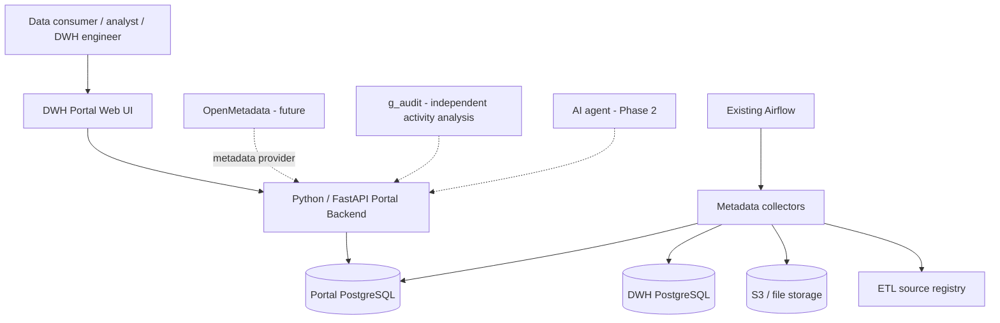
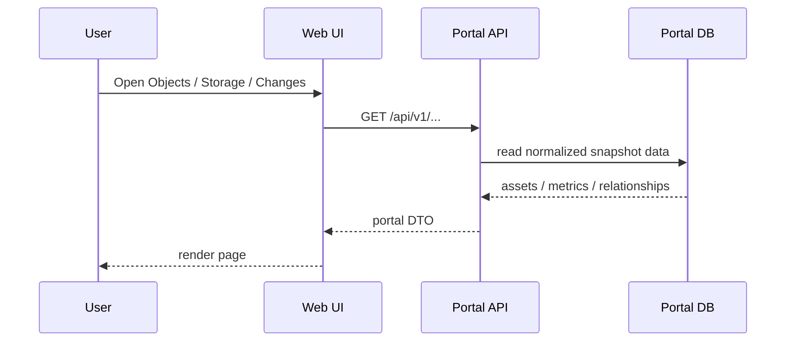
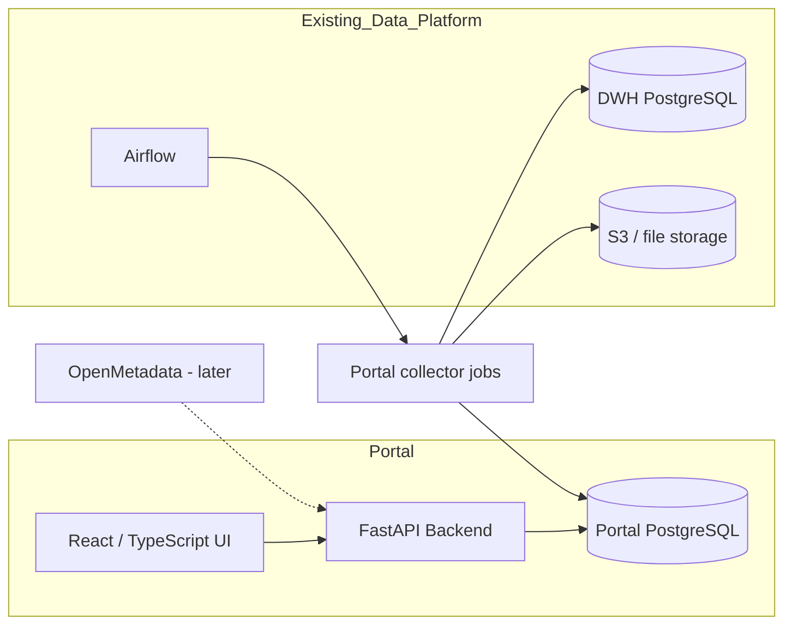
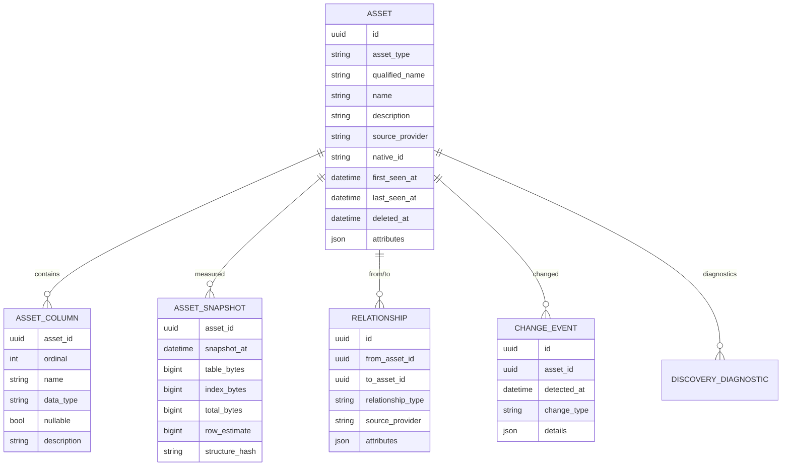
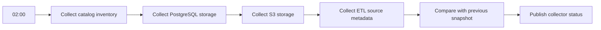
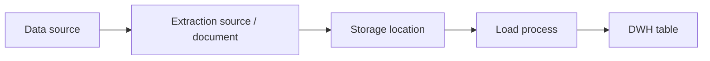
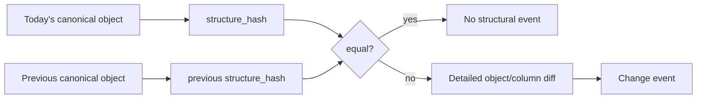
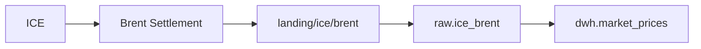
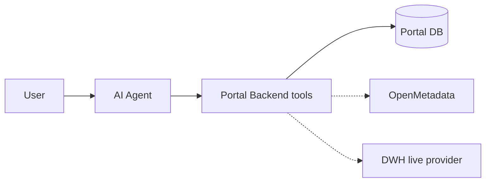

# DWH Portal - Architecture and Design

- **Version:** MVP / architecture direction
- **Date:** 2026-09-06
- **Updated:** 2026-10-24
- **Status:** Architecture overview; planned additions are not implementation claims

## 1. Purpose

DWH Portal — единая точка входа к каталогу данных, администрированию ingestion,
части мониторинга и деталям конкретных загрузок. Общие UI и FastAPI сохраняются
при возможном переходе на OpenMetadata или аналог.

Существующий metadata-driven ingestion registry остаётся рабочим механизмом.
Минимальный стабильный каталог нужен сейчас; полноценная платформа данных
может появиться существенно позже. Миграция не является условием MVP.

Согласованные решения изложены в ADR-002 и ADR бизнес-доменов. Текущее
поведение задают `openspec/specs/catalog/spec.md` и `ingestion/spec.md`.
OpenLineage receiver, модель выполнений и включение Python metadata-контракта
в основной pipeline — планируемые дополнения, не функции текущего архива.

## 2. Объём MVP

### Phase 1

- каталог database/schema/table/view;
- поиск и фильтрация;
- страница деталей объекта;
- описания таблиц/колонок из метаданных/комментариев PostgreSQL;
- размер хранилища и распределение storage;
- исторические снимки хранилища;
- логическая схема source → handler → TABLE/VIEW;
- проваливание в конкретные загрузки и постраничный `sys.log_files`;
- отслеживание структурных изменений объектов;
- здоровье collector / freshness status.

### Независимые направления и последующие этапы

- анализ пользовательской активности на основе `g_audit` — независимо от
  OpenLineage и выбора платформы метаданных;
- OpenLineage receiver и отдельная модель выполнений — поэтапное развитие
  мониторинга; графическая визуализация каждого запуска не обязательна для MVP;
- подключение явного `get_metadata(config)` наряду с AST;
- OM или аналог — при появлении обоснованной потребности, без фиксированного срока;
- AI, semantic search, column-level lineage и governance — вне текущего минимума.

## 3. Архитектурные принципы

1. **Браузер общается только с Portal API.**
2. **Страницы UI не запускают сканирование метаданных против DWH.**
3. **Каталог и размеры собираются снимками; события выполнений и live-журнал
   загрузок имеют отдельные пути получения.**
4. **Контракты Portal API используют каноническую продуктовую модель, а не
   provider-native DTO.**
5. **OM или аналог может стать источником каталога за Portal API;
   конкретная платформа не является контрактом frontend.**
6. **Прямой доступ к DWH/S3 зарезервирован для операций, которым реально нужны
   live-данные.**
7. **Сбои сбора локализуются и наблюдаемы.**
8. **Логическая схема и конкретные выполнения разделены; AST и явные
   metadata-контракты — дополняющие способы получения схемы до первого запуска.**

## 4. System context



## 5. Путь runtime-запроса

Обычный путь пользовательского запроса намеренно короткий:



Запрос страницы не запускает DWH-wide scan. Исключение из снимочного пути —
постраничное live-чтение `sys.log_files` для registry extraction source.
Планируемый приём OpenLineage-событий не запускается пользовательским чтением.

## 6. Deployment view



Рекомендуемая граница развёртывания:

```text
portal-web        stateless
portal-api        stateless
portal-db         persistent
collector jobs    launched/orchestrated by existing Airflow
```

## 7. Дизайн компонентов backend

Текущий read-path: Portal API → services → PortalStore → Portal DB.
Collectors и adapters отдельно читают providers PostgreSQL, registry и
исходников, затем обновляют каноническую модель. Открытие каталожной страницы
не запускает discovery и не вызывает loader metadata endpoint.

`MetadataProvider` текущего кода предоставляет `list_assets()` / `get_asset()`;
`LineageProvider` — `list_extraction_sources()` / `resolve_process_metadata()`.
Это внутренние порты, а не универсальное API будущей платформы.

AST-адаптеры не исполняют loaders. Планируемый resolver
`get_metadata(config)` также обслуживает сбор схемы, а не страницу UI.
Наблюдения OpenLineage в дальнейшем поступают через отдельный receiver,
сохраняются исходными событиями и наполняют проекцию выполнений.

## 8. Структура репозитория

Используются существующие каталоги:

```text
backend/core-service/src/
  api/portal/                 # product API каталога
  domains/catalog/            # модели, services, repositories, providers, collectors
    lineage_adapters/         # независимые источники логической схемы
  domains/admin/              # управление registry
  domains/documents/          # приём документов
  infrastructure/db/          # SQL persistence и миграции
frontend/web/src/modules/     # catalog, admin, documents и другие UI-модули
```

Ответственность будущих модулей выполнений и активности определена в
`core-service/portal-business-domains.md`; физическая раскладка уточняется
при реализации. Отдельные приложения, микросервисы и графовая БД не требуются
этим решением.

## 9. Каноническая модель метаданных



## 10. Сбор каталога

Collector каталога PostgreSQL читает метаданные через выделенное read-only
соединение.

Источники включают:

```text
pg_database
pg_namespace
pg_class
pg_attribute
pg_description
pg_constraint
pg_indexes / catalog equivalents
```

Collector не выполняет полные `COUNT(*)` по таблицам только чтобы заполнить UI.

Для числа строк используются оценки, пригодные для каталога.

## 11. Сбор storage

### PostgreSQL

Собирать как минимум:

```text
table_bytes
index_bytes
total_bytes
row_estimate
```

Типичные функции/данные каталога:

```text
pg_relation_size(...)
pg_indexes_size(...)
pg_total_relation_size(...)
```

### S3 / file storage

Собирать метрики логического prefix / storage-location, а не по одному Portal
asset на каждый runtime-файл.

Типичная агрегация:

```text
logical storage location
object_count
size_bytes
snapshot_at
```

## 12. Расписание сбора

Начальный baseline: ежедневно.



Позже расписание можно разделить по требованиям к freshness метрик.

## 13. Lineage source-to-DWH

Первая цепочка lineage строится из `sys.data_extraction_sources` и метаданных
загрузчиков.



Для email-источников:

```text
extract_source_type_id = 1
extract_options         = ExtractEmailOptions
storage_options         = ExtractStorageOptions
load_options            = ExtractLoadOptions
```

### Python loaders

`LoadPythonHandlerOption.module` и `LoadPythonExtendedHandlerOption.module`
идентифицируют loader-модуль. Схема может извлекаться двумя способами:

| Способ | Свойства |
|---|---|
| AST | Поддерживаемые конструкции исходников; без импорта и исполнения; не требует metadata-метода |
| `get_metadata()` / `get_metadata(config)` | Явные зависимости handler для конфигурации; отдельный безопасный вызов без `load_file()` |

Оба работают до первого запуска. AST не объявляется только временным fallback;
покрытие и стоимость поддержки определяют его применение. В текущем pipeline
Python discovery использует AST; подключение явного контракта планируется.

Metadata payload содержит `schema_version`, имя handler, `reads_from` /
`writes_to` с квалифицированными ссылками на datasets. Пример и требования
к безопасному вызову — ADR-002, разделы 7–8.

У связей сохраняются происхождение и свидетельства. Неоднозначности и
расхождения способов обнаружения диагностируются; они не перезаписываются
молча. Воспроизводимый AST-разбор не гарантирует полноту зависимостей, как и
наличие явного metadata-метода не гарантирует совпадение с runtime-поведением.

### Два представления потока

Логический граф описывает datasets и процессы без привязки к дню. Граф
выполнения описывает конкретный запуск, статусы, время, сообщённые входы и
выходы, связанные файлы. Он ссылается на логические объекты; runId и дата не
создают новые логические таблицы или handlers.

Схема не строится простым объединением всей истории. Одно выполнение не
подтверждает все условные ветки; отсутствие связи в запуске не удаляет её из
схемы. Достоверность наблюдения определяется тем, что фактически сообщил
producer: повторение объявленной конфигурации не доказывает реальный I/O.

Планируемые OpenLineage RunEvent хранятся исходными JSON с отдельными атрибутами
приёма; проекция запусков пересоздаётся из событий. На первом этапе UI может
показывать списки и детали выполнений без отдельной графической сцены.

### REST loaders

Конвенция MVP:

```text
Runtime  : <url_path>
Metadata : GET <url_path>/metadata
```

Endpoint возвращает тот же логический контракт метаданных.

## 14. Отслеживание изменений

Phase 1 отслеживает:

```text
ADDED
REMOVED
RENAMED
STRUCTURE_CHANGED
DESCRIPTION_CHANGED
```

Нормализованная структура хешируется на каждом прогоне каталога.



Удалённый объект soft-delete'ится в Portal DB, чтобы исторические снимки и
история изменений оставались запрашиваемыми.

## 15. Дизайн API

### Overview

```text
GET /api/v1/overview
```

Возвращает:

```text
asset counts
storage totals
recent change summary
collector freshness
```

### Assets

```text
GET /api/v1/assets
GET /api/v1/assets/{asset_id}
GET /api/v1/assets/{asset_id}/columns
GET /api/v1/assets/{asset_id}/lineage
```

Фильтры:

```text
q
database
schema
type
source
status
changed_since
sort
page/page_size
```

### Storage

```text
GET /api/v1/storage
GET /api/v1/storage/history
```

### Changes

```text
GET /api/v1/changes
GET /api/v1/changes/{change_id}
```

### Operations

```text
GET /api/v1/collection-status
```

## 16. Информационная архитектура UI

```text
DWH Portal
--------------------------------------------------------
Overview | Objects | Storage | Lineage | Changes

Phase 2:
Overview | Objects | Storage | Usage | Lineage | Changes | Ask AI
```

## 17. UI concept - Overview

Только иллюстративные значения.

```text
+---------------------------------------------------------------+
| DWH Overview                                                   |
+-------------------+--------------------+------------------------+
| Objects           | Total storage      | Changes 24h            |
| 4,812             | 18.7 TB            | 23                     |
| 3,921 tables      | 12.4 TB data       | +7 added               |
|   891 views       |  6.3 TB indexes    | 14 changed / 2 removed |
+-------------------+--------------------+------------------------+

Storage by schema
raw       ####################  7.9 TB
history   ############          4.8 TB
dwh       ##########            3.9 TB
stage     #####                 2.1 TB

Recent changes
+ raw.ice_options
~ dwh.market_prices   + column currency
- stage.old_prices
```

## 18. UI concept - Objects

```text
Objects

[ Search objects.............................................. ]

Database [All v]  Schema [All v]  Type [All v]  Source [All v]
Status   [Active v]

Object                    Type      Size       Rows       Changed
------------------------------------------------------------------
dwh.market_prices         TABLE     128 GB     ~420 M     yesterday
dwh.instruments           TABLE      31 GB      ~82 M     12 Aug
raw.ice_brent             TABLE      84 GB     ~310 M     today
mart.commodity_prices     VIEW        -           -       4 Aug
```

## 19. UI concept - Object detail

```text
dwh.market_prices                                      TABLE

Market prices and settlement values

Database        DWH
Schema          dwh
Size            128 GB
Indexes          31 GB
Rows            ~420 M
Last scan       06 Sep 2026 02:12

[Overview] [Columns] [Lineage] [Storage] [Changes]

Columns
------------------------------------------------------------------
instrument_id       bigint          Instrument identifier
trade_date          date            Trading date
settlement_price    numeric(18,6)   Settlement price
currency            varchar(3)      Currency
```

Та же страница объекта должна показывать происхождение источника, а не
заставлять обычного пользователя открывать OpenMetadata.

## 20. UI concept - Storage

```text
Storage                                            As of 02:15

Total                                                18.7 TB
Data                                                 12.4 TB
Indexes                                               6.3 TB

By schema
------------------------------------------------------------------
raw                                                   7.9 TB
history                                               4.8 TB
dwh                                                   3.9 TB
stage                                                 2.1 TB

Largest objects
------------------------------------------------------------------
history.transactions                                 2.3 TB
raw.trade_events                                     1.7 TB
dwh.fact_sales                                       0.8 TB
```

Исторические снимки позволяют строить тренды без запросов к live-таблицам DWH
в момент рендера.

## 21. UI concept - Lineage



Требования к UI:

- обход upstream/downstream;
- визуальное различение source, storage, process и database assets;
- переход к деталям объекта;
- unresolved targets показываются явно, а не молча опускаются;
- структурные связи визуально отличаются от data-flow lineage.

## 22. UI concept - Changes

```text
Changes                                    Period [Last 7 days v]

Added                 Changed                 Removed
  18                      37                       4

06 Sep
------------------------------------------------------------------
+ raw.ice_options
  New table, 14 columns

~ dwh.market_prices
  + settlement_currency varchar(3)

~ dwh.customer
  customer_code varchar(20) -> varchar(50)

- stage.old_ice_prices
```

## 23. Freshness и diagnostics

Каждая пользовательская страница, зависящая от снимков, должна показывать
freshness.

Примеры:

```text
Metadata updated: 06 Sep 2026 02:12
Storage updated : 06 Sep 2026 02:17
Lineage updated : 06 Sep 2026 02:19
```

Статус collector должен различать:

```text
SUCCESS
PARTIAL
FAILED
STALE
```

Частичный сбой метаданных source/loader не должен скрывать остальной каталог.

## 24. Security

Минимум Phase 1:

- read-only доступ collectors к DWH;
- credentials БД не возвращаются на frontend;
- raw secrets соединений Airflow не персистятся в Portal DB;
- runtime REST payload/headers не персистятся без whitelist;
- `access_level` сохраняется как метаданные для будущих правил авторизации;
- Portal API — единственный browser-facing интерфейс данных.

## 25. Ожидания по производительности

Поскольку пользовательские чтения обслуживаются из Portal DB:

- список объектов должен пагинироваться;
- фильтрам нужны подходящие индексы;
- обход lineage ограничен глубиной/размером страницы;
- исторические снимки append-oriented;
- нет `COUNT(*)` по большим таблицам DWH для обычного отображения портала;
- дорогая enumeration S3 выполняется только в collectors.

## 26. План поставки MVP

### Workstream 1 - Foundation

- каркас FastAPI;
- схема Portal PostgreSQL;
- канонические доменные модели;
- конфигурация и интерфейсы providers;
- модель прогона collector / freshness.

### Workstream 2 - Catalog

- collector метаданных PostgreSQL;
- комментарии и описания колонок;
- API `Objects`;
- API/UI деталей объекта;
- поиск/фильтрация/пагинация.

### Workstream 3 - Storage

- collector размеров PostgreSQL;
- collector размеров logical-prefix S3 там, где нужно;
- ежедневные снимки;
- API overview/storage;
- UI storage.

### Workstream 4 - Source lineage

- парсер `sys.data_extraction_sources`;
- маппинг `ExtractEmailOptions`, `ExtractStorageOptions`, `ExtractLoadOptions`;
- AST discovery поддерживаемых Python-конструкций;
- явный Python `get_metadata(config)` — дополнительный способ в последующем change;
- resolver REST `/metadata`;
- persistence связей;
- API/UI lineage.

### Workstream 5 - Changes

- нормализация/хеш структуры;
- обнаружение add/remove/change;
- детальный column diff;
- поддержка rename там, где надёжно;
- API/UI Changes.

### Workstream 6 - Hardening

- Airflow DAGs;
- retries/идемпотентность;
- diagnostics;
- статус collector;
- граница RBAC;
- logging/metrics;
- operational documentation.

## 27. Точки расширения Phase 2

### Usage/activity

Отдельный pipeline на основе `g_audit` будет наполнять агрегаты пользовательской
активности. Его реализация независима от OpenLineage и OM.

Планируемая граница backend:

```text
UsageProvider
get_asset_usage()
get_top_assets()
get_unused_assets()
get_usage_trend()
```

### AI

AI-агент будет использовать tools Portal backend вместо прямых запросов к
OpenMetadata.



Это позволяет вопросы, комбинирующие метаданные, lineage, storage, changes и
позже usage.

## 28. Возможный переход на OpenMetadata или аналог

Сейчас Portal DB и существующие providers обслуживают каталог, схема потока
собирается registry/SQL/AST-адаптерами. Позднее платформа может стать источником
каталога, описаний, lineage и других поддерживаемых метаданных за Portal API.
Распределение истории и размеров определяется проверкой покрытия; постоянное
дублирование авторитетного каталога не является целью.

Собственные UI и backend сохраняют функции единой точки входа и специфичного
администрирования. Цель — минимизировать изменения UI, а не обещать их отсутствие.

При реализации OpenLineage выбираются стабильные namespace/name и сохраняются
неизменённые payload. Совместимость с выбранной версией OM проверяется одним
и тем же реальным событием у собственного receiver и OM. Сохранённые события
должны допускать replay без штатной конвертации JSON; настройка mapping,
каталога и авторизации получателя выполняется отдельно.

Приём RunEvent платформой не гарантирует сохранение всех custom facets и
отдельного графа каждого запуска. История выполнений и исходный архив
сохраняются независимо, пока их полное покрытие не подтверждено.
Подробное решение — ADR-002, раздел 17.1. Срок миграции не установлен.

## 29. Ключевое архитектурное решение

Долгоживущая продуктовая граница:

```text
                       DWH Portal
                +---------------------+
User ---------->| UI                  |
                | Python Backend      |
                +----------+----------+
                           |
                    canonical model
                           |
          +----------------+----------------+
          |                |                |
      Portal DB           DWH/S3        OpenMetadata
      snapshots           providers        later
```

Это позволяет поддерживать минимальный каталог сейчас, постепенно добавлять
мониторинг выполнений и сохранять возможность перехода на платформу метаданных
без зависимости текущего продукта от сроков её внедрения.
