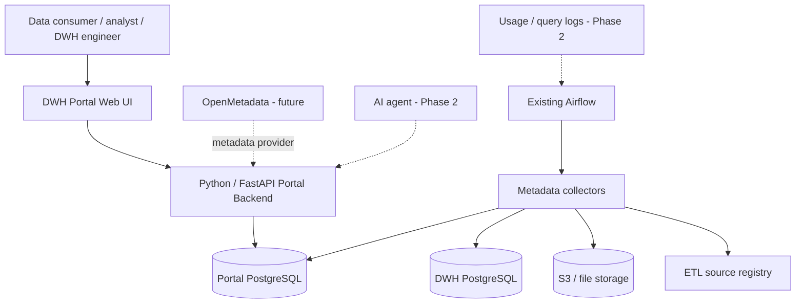
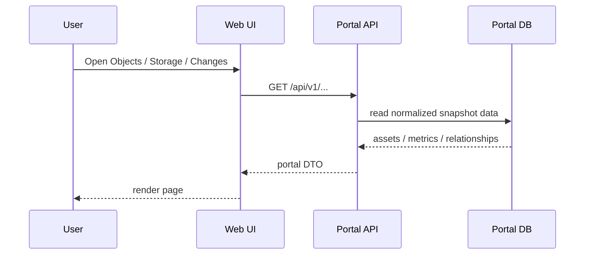
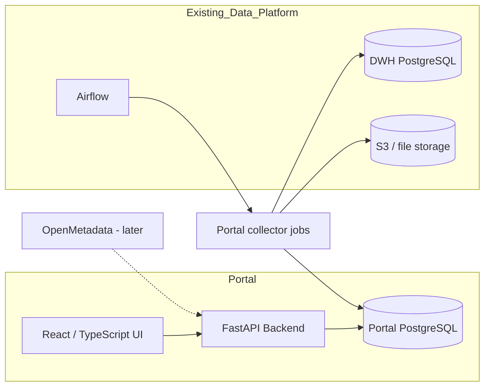
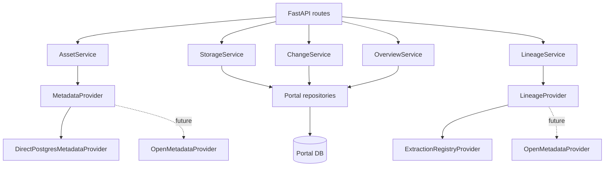
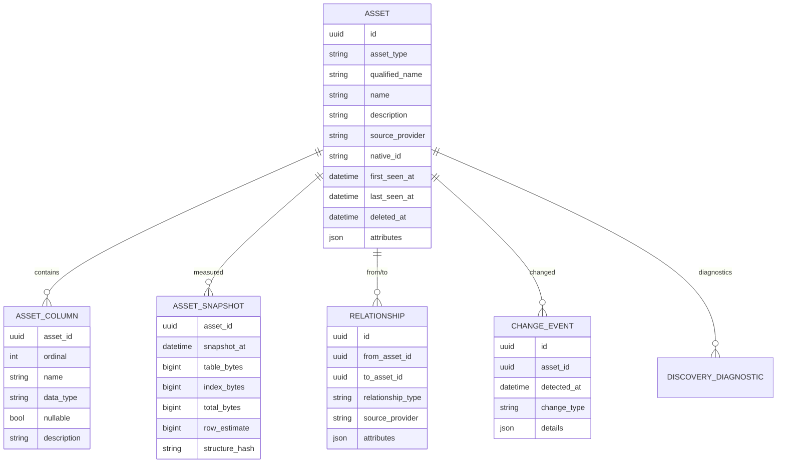
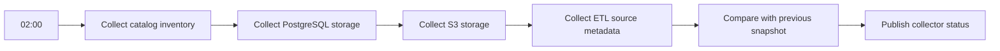
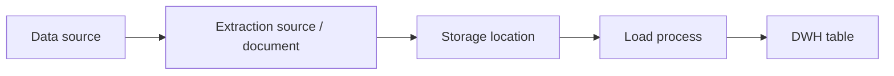
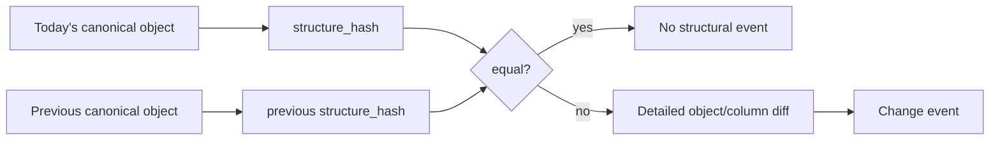
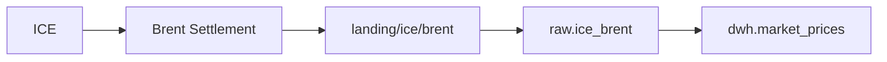
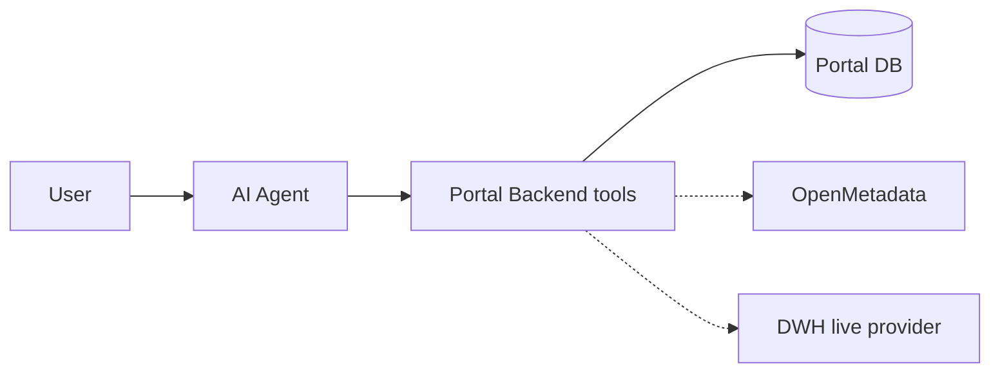

# DWH Portal - Architecture and Design

- **Version:** MVP / Phase 1
- **Date:** 2026-09-06
- **Status:** Initial design

## 1. Purpose

DWH Portal — пользовательское приложение каталога и operational metadata для
обнаружения активов DWH, понимания их происхождения и зависимостей, мониторинга
объёма хранилища и просмотра структурных изменений во времени.

Портал намеренно отделён от OpenMetadata.

OpenMetadata позже может стать system of record для метаданных, но backend и
frontend DWH Portal — долгоживущие продуктовые компоненты.

## 2. Объём MVP

### Phase 1

- каталог database/schema/table/view;
- поиск и фильтрация;
- страница деталей объекта;
- описания таблиц/колонок из метаданных/комментариев PostgreSQL;
- размер хранилища и распределение storage;
- исторические снимки хранилища;
- lineage source-to-DWH;
- отслеживание структурных изменений объектов;
- здоровье collector / freshness status.

### Phase 2

- AI-диалог;
- аналитика использования/активности БД из query/audit logs;
- OpenMetadata provider и интеграция governance;
- более богатый semantic search;
- опциональный column-level lineage.

## 3. Архитектурные принципы

1. **Браузер общается только с Portal API.**
2. **Страницы UI не запускают сканирование метаданных против DWH.**
3. **Operational metadata собирается периодически и хранится как снимки.**
4. **Контракты Portal API используют каноническую продуктовую модель, а не
   provider-native DTO.**
5. **OpenMetadata — заменяемый metadata provider, а не контракт backend для
   frontend.**
6. **Прямой доступ к DWH/S3 зарезервирован для операций, которым реально нужны
   live-данные.**
7. **Сбои сбора локализуются и наблюдаемы.**

## 4. System context



## 5. Путь runtime-запроса

Обычный путь пользовательского запроса намеренно короткий:



Запрос страницы не запускает DWH-wide scan.

## 6. Deployment view



Рекомендуемая граница развёртывания:

```text
portal-web        stateless
portal-api        stateless
portal-db         persistent
collector jobs    launched/orchestrated by existing Airflow
```

## 7. Дизайн компонентов backend



### Ответственность providers

`MetadataProvider`

```text
list_assets()
get_asset()
get_columns()
search_assets()
```

`LineageProvider`

```text
get_relationships()
resolve_process_targets()
```

Collectors отделены от request-time providers, потому что создают персистентные
снимки.

## 8. Предлагаемая структура репозитория

```text
dwh-portal/
├── backend/
│   └── app/
│       ├── api/
│       │   ├── overview.py
│       │   ├── assets.py
│       │   ├── storage.py
│       │   ├── lineage.py
│       │   ├── changes.py
│       │   └── collection_status.py
│       ├── domain/
│       │   ├── asset.py
│       │   ├── relationship.py
│       │   ├── snapshot.py
│       │   ├── change.py
│       │   └── diagnostic.py
│       ├── services/
│       │   ├── asset_service.py
│       │   ├── storage_service.py
│       │   ├── lineage_service.py
│       │   ├── change_service.py
│       │   └── overview_service.py
│       ├── providers/
│       │   ├── metadata/
│       │   │   ├── postgres.py
│       │   │   └── openmetadata.py       # later
│       │   ├── lineage/
│       │   │   ├── extraction_registry.py
│       │   │   └── openmetadata.py       # later
│       │   └── storage/
│       │       ├── postgres.py
│       │       └── s3.py
│       └── repositories/
│           └── portal_db/
├── collectors/
│   ├── catalog/
│   ├── storage/
│   ├── extraction_registry/
│   └── changes/
└── frontend/
```

## 9. Каноническая модель метаданных



## 10. Сбор каталога

Collector каталога PostgreSQL читает метаданные через выделенное read-only
соединение.

Источники включают:

```text
pg_database
pg_namespace
pg_class
pg_attribute
pg_description
pg_constraint
pg_indexes / catalog equivalents
```

Collector не выполняет полные `COUNT(*)` по таблицам только чтобы заполнить UI.

Для числа строк используются оценки, пригодные для каталога.

## 11. Сбор storage

### PostgreSQL

Собирать как минимум:

```text
table_bytes
index_bytes
total_bytes
row_estimate
```

Типичные функции/данные каталога:

```text
pg_relation_size(...)
pg_indexes_size(...)
pg_total_relation_size(...)
```

### S3 / file storage

Собирать метрики логического prefix / storage-location, а не по одному Portal
asset на каждый runtime-файл.

Типичная агрегация:

```text
logical storage location
object_count
size_bytes
snapshot_at
```

## 12. Расписание сбора

Начальный baseline: ежедневно.



Позже расписание можно разделить по требованиям к freshness метрик.

## 13. Lineage source-to-DWH

Первая цепочка lineage строится из `sys.data_extraction_sources` и метаданных
загрузчиков.



Для email-источников:

```text
extract_source_type_id = 1
extract_options         = ExtractEmailOptions
storage_options         = ExtractStorageOptions
load_options            = ExtractLoadOptions
```

### Python loaders

```text
LoadPythonHandlerOption.module
LoadPythonExtendedHandlerOption.module
```

трактуются как полные пути Python-модулей.

Модуль реализует:

```python
def get_metadata() -> dict:
    ...
```

Минимальный результат:

```json
{
  "schema_version": "1.0",
  "name": "ice_brent_loader",
  "writes_to": [
    {
      "type": "table",
      "database": "dwh",
      "schema": "raw",
      "name": "ice_brent"
    }
  ]
}
```

### REST loaders

Конвенция MVP:

```text
Runtime  : <url_path>
Metadata : GET <url_path>/metadata
```

Endpoint возвращает тот же логический контракт метаданных.

## 14. Отслеживание изменений

Phase 1 отслеживает:

```text
ADDED
REMOVED
RENAMED
STRUCTURE_CHANGED
DESCRIPTION_CHANGED
```

Нормализованная структура хешируется на каждом прогоне каталога.



Удалённый объект soft-delete'ится в Portal DB, чтобы исторические снимки и
история изменений оставались запрашиваемыми.

## 15. Дизайн API

### Overview

```text
GET /api/v1/overview
```

Возвращает:

```text
asset counts
storage totals
recent change summary
collector freshness
```

### Assets

```text
GET /api/v1/assets
GET /api/v1/assets/{asset_id}
GET /api/v1/assets/{asset_id}/columns
GET /api/v1/assets/{asset_id}/lineage
```

Фильтры:

```text
q
database
schema
type
source
status
changed_since
sort
page/page_size
```

### Storage

```text
GET /api/v1/storage
GET /api/v1/storage/history
```

### Changes

```text
GET /api/v1/changes
GET /api/v1/changes/{change_id}
```

### Operations

```text
GET /api/v1/collection-status
```

## 16. Информационная архитектура UI

```text
DWH Portal
--------------------------------------------------------
Overview | Objects | Storage | Lineage | Changes

Phase 2:
Overview | Objects | Storage | Usage | Lineage | Changes | Ask AI
```

## 17. UI concept - Overview

Только иллюстративные значения.

```text
+---------------------------------------------------------------+
| DWH Overview                                                   |
+-------------------+--------------------+------------------------+
| Objects           | Total storage      | Changes 24h            |
| 4,812             | 18.7 TB            | 23                     |
| 3,921 tables      | 12.4 TB data       | +7 added               |
|   891 views       |  6.3 TB indexes    | 14 changed / 2 removed |
+-------------------+--------------------+------------------------+

Storage by schema
raw       ####################  7.9 TB
history   ############          4.8 TB
dwh       ##########            3.9 TB
stage     #####                 2.1 TB

Recent changes
+ raw.ice_options
~ dwh.market_prices   + column currency
- stage.old_prices
```

## 18. UI concept - Objects

```text
Objects

[ Search objects.............................................. ]

Database [All v]  Schema [All v]  Type [All v]  Source [All v]
Status   [Active v]

Object                    Type      Size       Rows       Changed
------------------------------------------------------------------
dwh.market_prices         TABLE     128 GB     ~420 M     yesterday
dwh.instruments           TABLE      31 GB      ~82 M     12 Aug
raw.ice_brent             TABLE      84 GB     ~310 M     today
mart.commodity_prices     VIEW        -           -       4 Aug
```

## 19. UI concept - Object detail

```text
dwh.market_prices                                      TABLE

Market prices and settlement values

Database        DWH
Schema          dwh
Size            128 GB
Indexes          31 GB
Rows            ~420 M
Last scan       06 Sep 2026 02:12

[Overview] [Columns] [Lineage] [Storage] [Changes]

Columns
------------------------------------------------------------------
instrument_id       bigint          Instrument identifier
trade_date          date            Trading date
settlement_price    numeric(18,6)   Settlement price
currency            varchar(3)      Currency
```

Та же страница объекта должна показывать происхождение источника, а не
заставлять обычного пользователя открывать OpenMetadata.

## 20. UI concept - Storage

```text
Storage                                            As of 02:15

Total                                                18.7 TB
Data                                                 12.4 TB
Indexes                                               6.3 TB

By schema
------------------------------------------------------------------
raw                                                   7.9 TB
history                                               4.8 TB
dwh                                                   3.9 TB
stage                                                 2.1 TB

Largest objects
------------------------------------------------------------------
history.transactions                                 2.3 TB
raw.trade_events                                     1.7 TB
dwh.fact_sales                                       0.8 TB
```

Исторические снимки позволяют строить тренды без запросов к live-таблицам DWH
в момент рендера.

## 21. UI concept - Lineage



Требования к UI:

- обход upstream/downstream;
- визуальное различение source, storage, process и database assets;
- переход к деталям объекта;
- unresolved targets показываются явно, а не молча опускаются;
- структурные связи визуально отличаются от data-flow lineage.

## 22. UI concept - Changes

```text
Changes                                    Period [Last 7 days v]

Added                 Changed                 Removed
  18                      37                       4

06 Sep
------------------------------------------------------------------
+ raw.ice_options
  New table, 14 columns

~ dwh.market_prices
  + settlement_currency varchar(3)

~ dwh.customer
  customer_code varchar(20) -> varchar(50)

- stage.old_ice_prices
```

## 23. Freshness и diagnostics

Каждая пользовательская страница, зависящая от снимков, должна показывать
freshness.

Примеры:

```text
Metadata updated: 06 Sep 2026 02:12
Storage updated : 06 Sep 2026 02:17
Lineage updated : 06 Sep 2026 02:19
```

Статус collector должен различать:

```text
SUCCESS
PARTIAL
FAILED
STALE
```

Частичный сбой метаданных source/loader не должен скрывать остальной каталог.

## 24. Security

Минимум Phase 1:

- read-only доступ collectors к DWH;
- credentials БД не возвращаются на frontend;
- raw secrets соединений Airflow не персистятся в Portal DB;
- runtime REST payload/headers не персистятся без whitelist;
- `access_level` сохраняется как метаданные для будущих правил авторизации;
- Portal API — единственный browser-facing интерфейс данных.

## 25. Ожидания по производительности

Поскольку пользовательские чтения обслуживаются из Portal DB:

- список объектов должен пагинироваться;
- фильтрам нужны подходящие индексы;
- обход lineage ограничен глубиной/размером страницы;
- исторические снимки append-oriented;
- нет `COUNT(*)` по большим таблицам DWH для обычного отображения портала;
- дорогая enumeration S3 выполняется только в collectors.

## 26. План поставки MVP

### Workstream 1 - Foundation

- каркас FastAPI;
- схема Portal PostgreSQL;
- канонические доменные модели;
- конфигурация и интерфейсы providers;
- модель прогона collector / freshness.

### Workstream 2 - Catalog

- collector метаданных PostgreSQL;
- комментарии и описания колонок;
- API `Objects`;
- API/UI деталей объекта;
- поиск/фильтрация/пагинация.

### Workstream 3 - Storage

- collector размеров PostgreSQL;
- collector размеров logical-prefix S3 там, где нужно;
- ежедневные снимки;
- API overview/storage;
- UI storage.

### Workstream 4 - Source lineage

- парсер `sys.data_extraction_sources`;
- маппинг `ExtractEmailOptions`, `ExtractStorageOptions`, `ExtractLoadOptions`;
- resolver Python `get_metadata()`;
- resolver REST `/metadata`;
- persistence связей;
- API/UI lineage.

### Workstream 5 - Changes

- нормализация/хеш структуры;
- обнаружение add/remove/change;
- детальный column diff;
- поддержка rename там, где надёжно;
- API/UI Changes.

### Workstream 6 - Hardening

- Airflow DAGs;
- retries/идемпотентность;
- diagnostics;
- статус collector;
- граница RBAC;
- logging/metrics;
- operational documentation.

## 27. Точки расширения Phase 2

### Usage/activity

Отдельный usage pipeline будет наполнять агрегаты использования.

Планируемая граница backend:

```text
UsageProvider
get_asset_usage()
get_top_assets()
get_unused_assets()
get_usage_trend()
```

### AI

AI-агент будет использовать tools Portal backend вместо прямых запросов к
OpenMetadata.



Это позволяет вопросы, комбинирующие метаданные, lineage, storage, changes и
позже usage.

## 28. Путь миграции на OpenMetadata

Phase 1:

```text
Portal Backend -> Direct PostgreSQL metadata provider
Portal Backend -> Portal DB snapshots
```

Позже:

```text
Portal Backend -> OpenMetadata provider
Portal Backend -> Portal DB snapshots/history
Portal Backend -> DWH/S3 for selected live/source-specific operations
```

OpenMetadata не заменяет Portal backend.

## 29. Ключевое архитектурное решение

Долгоживущая продуктовая граница:

```text
                       DWH Portal
                +---------------------+
User ---------->| UI                  |
                | Python Backend      |
                +----------+----------+
                           |
                    canonical model
                           |
          +----------------+----------------+
          |                |                |
      Portal DB           DWH/S3        OpenMetadata
      snapshots           providers        later
```

Это позволяет стартовать сразу и сохранить чистый путь миграции к полноценной
платформе метаданных.
